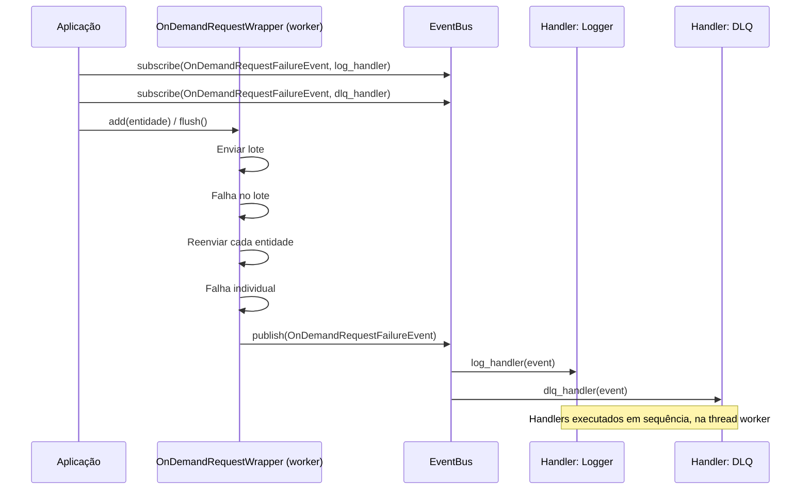

# Eventos

Sistema de eventos para comunicação desacoplada entre componentes do SDK.

## Módulo

```python
from sankhya_sdk.events import EventBus, OnDemandRequestFailureEvent
```

---

## EventBus

Barramento de eventos singleton para publicação e assinatura de eventos.

Permite desacoplamento entre componentes que geram eventos e handlers que os processam. Thread-safe usando locks para operações de registro/publicação.

### Características

| Característica | Descrição |
|----------------|-----------|
| **Singleton** | Instância única global |
| **Thread-safe** | Operações protegidas por lock |
| **Desacoplado** | Publishers e subscribers independentes |

### Métodos

#### `subscribe(event_type, handler)`

Registra um handler para um tipo de evento.

```python
from sankhya_sdk.events import EventBus, OnDemandRequestFailureEvent

def on_failure(event: OnDemandRequestFailureEvent) -> None:
    print(f"Falha em {event.entity}: {event.exception}")
    # Log, notificação, retry, etc.

EventBus.subscribe(OnDemandRequestFailureEvent, on_failure)
```

| Parâmetro | Tipo | Descrição |
|-----------|------|-----------|
| `event_type` | `Type[TEvent]` | Tipo do evento a ser assinado |
| `handler` | `Callable[[TEvent], None]` | Função que será chamada quando o evento for publicado |

---

#### `unsubscribe(event_type, handler) -> bool`

Remove um handler de um tipo de evento.

```python
success = EventBus.unsubscribe(OnDemandRequestFailureEvent, on_failure)
print(f"Handler removido: {success}")
```

| Parâmetro | Tipo | Descrição |
|-----------|------|-----------|
| `event_type` | `Type[TEvent]` | Tipo do evento |
| `handler` | `Callable[[TEvent], None]` | Handler a ser removido |

**Retorna:** `True` se o handler foi removido, `False` caso contrário.

---

#### `publish(event)`

Publica um evento para todos os handlers registrados.

```python
from sankhya_sdk.events import EventBus, OnDemandRequestFailureEvent
from sankhya_sdk.models.transport import Partner

event = OnDemandRequestFailureEvent(
    entity=Partner(code=1),
    is_update=True,
    exception=ValueError("Campo inválido"),
    error_message="Erro na validação",
    retry_count=3
)

EventBus.publish(event)
```

!!! note "Tratamento de Erros"
    Os handlers são chamados em sequência, na thread que publica. Exceções
    (`Exception`) lançadas por um handler são descartadas silenciosamente, sem
    log, para não interromper os demais handlers: trate e registre os erros
    dentro do próprio handler.

---

#### `clear(event_type=None)`

Remove todos os handlers de um tipo de evento ou todos os handlers.

```python
# Remove handlers de um tipo específico
EventBus.clear(OnDemandRequestFailureEvent)

# Remove todos os handlers
EventBus.clear()
```

---

#### `has_handlers(event_type) -> bool`

Verifica se há handlers registrados para um tipo de evento.

```python
if EventBus.has_handlers(OnDemandRequestFailureEvent):
    print("Há handlers registrados para falhas")
```

---

#### `handler_count(event_type) -> int`

Retorna o número de handlers registrados para um tipo de evento.

```python
count = EventBus.handler_count(OnDemandRequestFailureEvent)
print(f"Handlers registrados: {count}")
```

---

## OnDemandRequestFailureEvent

Evento disparado quando uma entidade falha no processamento on-demand
(`OnDemandRequestWrapper` e `AsyncOnDemandRequestWrapper`).

### Quando é Disparado

Como no SDK .NET, o worker envia as entidades da fila em lote; se o lote
falha, cada entidade é reenviada sozinha, e o evento é publicado para cada
entidade cujo envio individual também falhou (ou cuja requisição não pôde ser
montada). Timeout e deadlock são repetidos uma vez, de imediato, antes de a
requisição ser considerada falha.

O `EventBus.publish` chama os handlers em sequência, na thread que publica:
no `OnDemandRequestWrapper`, a thread worker do wrapper; no
`AsyncOnDemandRequestWrapper`, a tarefa worker, no event loop (handlers são
sempre síncronos).

!!! warning "`flush()` dentro de um handler"
    Num handler do `OnDemandRequestWrapper`, `flush()` apenas solicita o envio
    da fila e retorna sem aguardar: o handler roda na própria thread worker,
    que é quem envia a fila. `dispose()` (ou `ctx.dispose()`) dentro de um
    handler não funciona: o wrapper tentaria aguardar a própria thread.

### Atributos

| Atributo | Tipo | Descrição |
|----------|------|-----------|
| `entity` | `Any` | A entidade que falhou ao ser processada |
| `is_update` | `bool` | `True` se a requisição que falhou era de salvamento (`ServiceName.CRUD_SERVICE_SAVE`, inclusão ou alteração); `False` para qualquer outro serviço, como a remoção (`CRUD_SERVICE_REMOVE`). Como no .NET (`service == CrudServiceSave`) |
| `exception` | `BaseException` | A exceção que causou a falha |
| `error_message` | `Optional[str]` | Mensagem opcional; os wrappers on-demand não a preenchem (`None`) |
| `retry_count` | `int` | Os wrappers on-demand não o preenchem (sempre `0`) |

### Propriedades

#### `operation_type -> str`

`is_update` como string: `"update"` (falha de `CRUD_SERVICE_SAVE`) ou
`"create"`. Apesar do nome, `"create"` não indica uma inclusão: é retornado
sempre que `is_update` é `False`, ou seja, numa falha de remoção. Para decidir
o tratamento, use `is_update`.

### Exemplo de Uso

```python
import logging
import threading

from sankhya_sdk import SankhyaContext
from sankhya_sdk.enums import ServiceName
from sankhya_sdk.events import EventBus, OnDemandRequestFailureEvent
from sankhya_sdk.models.transport import Partner
from sankhya_sdk.request_wrappers import OnDemandRequestFactory

logger = logging.getLogger(__name__)


# Handler para falhas
def handle_failure(event: OnDemandRequestFailureEvent) -> None:
    operacao = "gravação" if event.is_update else "remoção"
    logger.error(
        f"Falha na {operacao} de {type(event.entity).__name__}: {event.exception}"
    )
    # Opcional: salvar em fila para retry posterior
    # dead_letter_queue.append(event.entity)


# Registrar handler antes de iniciar operações
EventBus.subscribe(OnDemandRequestFailureEvent, handle_failure)

ctx = SankhyaContext.from_settings()
key = OnDemandRequestFactory.create_instance(
    Partner, ServiceName.CRUD_SERVICE_SAVE, threading.Event(), context=ctx
)
try:
    on_demand = OnDemandRequestFactory.get_instance_by_key(key)
    assert on_demand is not None
    on_demand.add(Partner(code=1, is_active=True))
    on_demand.flush()  # Se houver falhas, o handler é chamado
finally:
    OnDemandRequestFactory.finalize_by_key(key)
    ctx.dispose()
    # Limpar ao finalizar (opcional)
    EventBus.unsubscribe(OnDemandRequestFailureEvent, handle_failure)
```

---

## Padrões de Uso

### Logging Centralizado

```python
import logging

from sankhya_sdk.events import EventBus, OnDemandRequestFailureEvent


def setup_failure_logging() -> None:
    logger = logging.getLogger("sankhya.failures")

    def log_failure(event: OnDemandRequestFailureEvent) -> None:
        logger.error(
            "Entity processing failed",
            extra={
                "entity_type": type(event.entity).__name__,
                "is_update": event.is_update,
                "error": str(event.exception),
            },
        )

    EventBus.subscribe(OnDemandRequestFailureEvent, log_failure)
```

### Dead Letter Queue

```python
from collections import deque

from sankhya_sdk.events import EventBus, OnDemandRequestFailureEvent

# Fila para entidades que falharam (deque é segura entre threads para
# append/popleft; o handler roda na thread worker do wrapper)
dead_letter_queue: deque = deque()


def enqueue_failed(event: OnDemandRequestFailureEvent) -> None:
    dead_letter_queue.append({
        "entity": event.entity,
        "is_update": event.is_update,
        "error": str(event.exception),
    })


EventBus.subscribe(OnDemandRequestFailureEvent, enqueue_failed)


# Depois, processar a fila manualmente
def process_dead_letter_queue() -> None:
    while dead_letter_queue:
        item = dead_letter_queue.popleft()
        print(f"Reprocessar {item['entity']}: {item['error']}")
```

### Notificação por Email/Slack

```python
from sankhya_sdk.events import EventBus, OnDemandRequestFailureEvent
from sankhya_sdk.exceptions import ServiceRequestDeadlockException


def send_slack_message(channel: str, text: str) -> None:
    ...  # Integração com o Slack


def notify_team(event: OnDemandRequestFailureEvent) -> None:
    # Deadlock já foi repetido uma vez pelo wrapper: avisa o time
    if isinstance(event.exception, ServiceRequestDeadlockException):
        send_slack_message(
            channel="#integrations",
            text=f"Falha crítica: {event.entity} - {event.exception}",
        )


EventBus.subscribe(OnDemandRequestFailureEvent, notify_team)
```

---

## Diagrama de Fluxo



---

## Ver Também

- [Request Wrappers](request-wrappers.md) - OnDemandRequestWrapper
- [Tratamento de Erros](../core-concepts/error-handling.md) - Estratégias de recuperação
