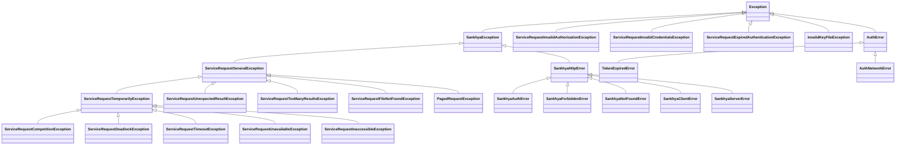

# Exceções

Documentação das exceções do SDK. As exceções da stack XML legada
(`SankhyaContext`, `SankhyaWrapper` e request wrappers) e as do Gateway JSON
(`SankhyaHttpError` e derivadas) ficam em `sankhya_sdk.exceptions`; as de
OAuth2 ficam em `sankhya_sdk.auth`.

## Hierarquia



O diagrama mostra as classes principais. As demais exceções de serviço
(`ServiceRequestPropertyValueException`, `ServiceRequestForeignKeyException`,
`ServiceRequestCanceledQueryException`, ...) também derivam de
`ServiceRequestGeneralException`.

!!! warning "Exceções de autenticação fora de `SankhyaException`"
    `ServiceRequestInvalidAuthorizationException`,
    `ServiceRequestInvalidCredentialsException` e
    `ServiceRequestExpiredAuthenticationException` derivam diretamente de
    `Exception`: um `except SankhyaException` não as captura.

## Importação

```python
from sankhya_sdk.exceptions import (
    # Base
    SankhyaException,
    ServiceRequestGeneralException,
    ServiceRequestTemporarilyException,

    # Autenticação (XML legado)
    ServiceRequestInvalidAuthorizationException,
    ServiceRequestInvalidCredentialsException,
    ServiceRequestExpiredAuthenticationException,

    # Erros temporários (XML legado)
    ServiceRequestCompetitionException,
    ServiceRequestDeadlockException,
    ServiceRequestTimeoutException,
    ServiceRequestUnavailableException,

    # Resultado, arquivos e paginação (XML legado)
    ServiceRequestUnexpectedResultException,
    ServiceRequestTooManyResultsException,
    ServiceRequestFileNotFoundException,
    InvalidKeyFileException,
    PagedRequestException,

    # HTTP (Gateway JSON)
    SankhyaHttpError,
    SankhyaAuthError,
    SankhyaForbiddenError,
    SankhyaNotFoundError,
    SankhyaClientError,
    SankhyaServerError,
    raise_for_status,
)

# Exceções de Autenticação OAuth2
from sankhya_sdk.auth import (
    AuthError,
    TokenExpiredError,
    AuthNetworkError,
)
```

## Como o SDK escolhe a exceção

Quando o servidor responde com `status="0"`, o `StatusMessageHelper`
procura trechos conhecidos na `statusMessage` e lança a exceção
correspondente (porta do `StatusMessageHelper` do SDK .NET). A
`statusMessage` chega em Base64 e é decodificada antes da busca, como no
.NET (texto que não é Base64 válido é usado como veio). Alguns exemplos:

| Trecho da mensagem do servidor | Exceção |
|--------------------------------|---------|
| `situação de concorrência`, `log de acessos`, `violação da restrição primary key 'PK_TSIRLG'` | `ServiceRequestCompetitionException` |
| `deadlock` | `ServiceRequestDeadlockException` |
| `tempo limite da consulta` | `ServiceRequestTimeoutException` |
| `I/O error`, `TDS protocol error`, `the connection object is closed`, ... | `ServiceRequestUnavailableException` |
| `A consulta foi cancelada` | `ServiceRequestCanceledQueryException` |
| `não autorizado` | `ServiceRequestInvalidAuthorizationException` |
| `Usuário/Senha inválido` | `ServiceRequestInvalidCredentialsException` |
| `Usuário expirou` | `ServiceRequestExpiredAuthenticationException` |
| qualquer outra mensagem | `ServiceRequestUnexpectedResultException` |

Antes de chegar ao seu código, algumas dessas exceções são repetidas
automaticamente pelo `SankhyaWrapper`; veja
[Retry Automático](../core-concepts/error-handling.md#retry-automatico).

---

## SankhyaException

Classe base das exceções do SDK (exceto as de autenticação da stack XML,
veja o aviso acima). Não define atributos próprios: a mensagem é `str(e)` e,
quando há uma exceção de origem, ela fica em `e.__cause__`.

### Uso

```python
from sankhya_sdk.exceptions import SankhyaException
from sankhya_sdk.models.transport import Partner
from sankhya_sdk.request_wrappers import SimpleCRUDRequestWrapper

# SimpleCRUDRequestWrapper.initialize(ctx) já chamado (ver Request Wrappers)
try:
    partner = SimpleCRUDRequestWrapper.find(Partner(code=1))
except SankhyaException as e:
    print(f"Erro: {e}")
    if e.__cause__ is not None:
        print(f"Causa: {e.__cause__}")
```

---

## ServiceRequestGeneralException

Base dos erros de requisição de serviço da stack XML.

### Atributos

| Atributo | Tipo | Descrição |
|----------|------|-----------|
| `request` | `ServiceRequest \| None` | Requisição que falhou |
| `response` | `ServiceResponse \| None` | Resposta do servidor, quando disponível |
| `request_xml` / `response_xml` | `str \| None` | XML da requisição/resposta, quando disponível |

A mensagem é `str(e)` e a causa, quando houver, fica em `e.__cause__`.

### Uso

```python
from sankhya_sdk.exceptions import ServiceRequestGeneralException
from sankhya_sdk.models.transport import Partner
from sankhya_sdk.request_wrappers import SimpleCRUDRequestWrapper

try:
    SimpleCRUDRequestWrapper.update(Partner(code=1, name="Novo Nome"))
except ServiceRequestGeneralException as e:
    print(f"Erro: {e}")
    if e.request is not None:
        print(f"Serviço: {e.request.service}")
    if e.response is not None:
        print(f"Mensagem do servidor: {e.response.status_message_text}")
```

---

## ServiceRequestUnexpectedResultException

Resultado inesperado. É lançada quando:

- o servidor retorna um erro cuja mensagem não corresponde a nenhum padrão
  conhecido (a mensagem original fica em `error_message`);
- `SimpleCRUDRequestWrapper.find`/`find_with_criteria` não encontram a
  entidade.

### Atributos

| Atributo | Tipo | Descrição |
|----------|------|-----------|
| `error_message` | `str` | Mensagem original (vazia quando não informada) |
| `request` | `ServiceRequest \| None` | Requisição que falhou |
| `response` | `ServiceResponse \| None` | Resposta do servidor |

### Uso

```python
from sankhya_sdk.exceptions import ServiceRequestUnexpectedResultException
from sankhya_sdk.models.transport import Partner
from sankhya_sdk.request_wrappers import SimpleCRUDRequestWrapper

try:
    partner = SimpleCRUDRequestWrapper.find(Partner(code=999999))
except ServiceRequestUnexpectedResultException as e:
    print(f"Resultado inesperado: {e}")
```

Para buscas em que a ausência é esperada, prefira `try_find`, que retorna
`None`. Mais de um resultado em `try_find`/`find` gera
`ServiceRequestTooManyResultsException`.

---

## ServiceRequestInvalidAuthorizationException

Sessão não autorizada: o servidor respondeu `não autorizado` ou a
requisição foi feita sem autenticação. Deriva de `Exception`.

O `SankhyaWrapper` trata essa exceção sozinho: invalida a sessão,
autentica de novo com as mesmas credenciais e repete a requisição. Ela só
chega ao seu código quando a sessão já tinha sido invalidada ou quando o
wrapper não tem credenciais. A mensagem é `str(e)`; não há atributos
adicionais.

---

## ServiceRequestInvalidCredentialsException

Login recusado (`Usuário/Senha inválido`). Deriva de `Exception` e não é
repetida automaticamente.

### Uso

```python
from sankhya_sdk import SankhyaContext
from sankhya_sdk.exceptions import ServiceRequestInvalidCredentialsException

try:
    ctx = SankhyaContext.from_settings()
except ServiceRequestInvalidCredentialsException as e:
    print(f"Credenciais recusadas: {e}")
    # Não adianta repetir: corrija SANKHYA_USERNAME / SANKHYA_PASSWORD
else:
    ctx.dispose()
```

`ServiceRequestExpiredAuthenticationException` (`Usuário expirou`) segue
o mesmo padrão.

---

## ServiceRequestCompetitionException

O Sankhya identificou a sessão como **duplicada**. É lançada para as
mensagens `situação de concorrência`, `log de acessos` ou violação da
`PK_TSIRLG` (tabela de log de acessos). Não indica lock de registro ou de
tabela.

Mensagem: `The session has been identified as duplicated by Sankhya`.

### Atributos

| Atributo | Tipo | Descrição |
|----------|------|-----------|
| `request` | `ServiceRequest \| None` | Requisição que falhou |
| `response` | `ServiceResponse \| None` | Resposta do servidor |

### Retry automático

- Em serviços **não transacionais** (consultas, `removeRecord`, ...), o
  `SankhyaWrapper` invalida a sessão, autentica de novo e repete a
  requisição **sem atraso**, até `max_retries` vezes (padrão 3).
- Em serviços **transacionais** (ex.: `CRUDServiceProvider.saveRecord`,
  usado por `SimpleCRUDRequestWrapper.update`), a exceção é propagada sem
  retry, para não repetir uma gravação.

### Uso

```python
import logging

from sankhya_sdk.exceptions import ServiceRequestCompetitionException
from sankhya_sdk.models.transport import Partner
from sankhya_sdk.request_wrappers import SimpleCRUDRequestWrapper

partner = Partner(code=1, name="Novo Nome")
try:
    SimpleCRUDRequestWrapper.update(partner)
except ServiceRequestCompetitionException as e:
    # saveRecord é transacional: o SDK não repetiu a gravação
    logging.warning(f"Sessão duplicada: {e}")
    SimpleCRUDRequestWrapper.update(partner)  # repetir, se fizer sentido
```

---

## ServiceRequestDeadlockException

Deadlock detectado no banco de dados (mensagem do servidor contendo
`deadlock`).

### Atributos

| Atributo | Tipo | Descrição |
|----------|------|-----------|
| `request` | `ServiceRequest \| None` | Requisição que falhou |
| `response` | `ServiceResponse \| None` | Resposta do servidor |

A mensagem (`str(e)`) é o texto retornado pelo servidor.

### Retry automático

- Em serviços **não transacionais**, o `SankhyaWrapper` repete com atraso
  linear: 15 s, 30 s e 45 s (`tentativa × RequestRetryDelay.STABLE`).
- Em serviços **transacionais** (ex.: `SimpleCRUDRequestWrapper.update`),
  a exceção é propagada imediatamente, sem retry.

### Uso

```python
import logging

from sankhya_sdk.exceptions import ServiceRequestDeadlockException
from sankhya_sdk.models.transport import Partner
from sankhya_sdk.request_wrappers import SimpleCRUDRequestWrapper

try:
    SimpleCRUDRequestWrapper.update(Partner(code=1, name="Novo Nome"))
except ServiceRequestDeadlockException as e:
    # Gravação (transacional): chega aqui na primeira ocorrência
    logging.error(f"Deadlock: {e}")
    raise
```

---

## ServiceRequestFileNotFoundException

Arquivo não encontrado. `SankhyaWrapper.get_file` (e
`SankhyaContext.get_file`) a lançam quando o servidor devolve a página HTML
de erro no lugar do arquivo (chave inválida ou arquivo inexistente). A
mensagem (`str(e)`) inclui a chave.

### Uso

```python
from sankhya_sdk import SankhyaContext
from sankhya_sdk.exceptions import ServiceRequestFileNotFoundException

with SankhyaContext.from_settings() as wrapper:
    try:
        file = wrapper.get_file("CHAVE_DO_ARQUIVO")
    except ServiceRequestFileNotFoundException as e:
        print(f"Arquivo não encontrado: {e}")
```

---

## InvalidKeyFileException

Chave de arquivo inválida para a sessão ou removida do Sankhya. Deriva de
`Exception`. No SDK .NET ela é lançada pelo download de arquivos; no SDK
Python, `get_file` sinaliza essa situação com
`ServiceRequestFileNotFoundException`, e `InvalidKeyFileException` não é
lançada pelo SDK.

---

## PagedRequestException

Erro durante uma requisição paginada (`PagedRequestWrapper`). Existem duas
classes com esse nome:

- `sankhya_sdk.exceptions.PagedRequestException`: porta da exceção do .NET
  (`request` e causa em `__cause__`);
- `sankhya_sdk.request_wrappers.PagedRequestException`: subclasse da
  anterior, lançada pelo `PagedRequestWrapper`, que acrescenta `page` e
  `inner_exception`.

Um `except` com qualquer uma das duas captura os erros de paginação.

### Atributos (`sankhya_sdk.request_wrappers.PagedRequestException`)

| Atributo | Tipo | Descrição |
|----------|------|-----------|
| `page` | `int` | Página que falhou. Na exceção lançada por `get_paged_results`/`get_paged_results_async` vale `0`: a página fica em `e.inner_exception.page` |
| `inner_exception` | `Exception \| None` | Exceção de origem (também em `e.__cause__`). Na exceção lançada pelo generator, é a exceção da página (com `page` preenchido), cujo `inner_exception` é o erro do serviço |
| `request` | `ServiceRequest \| None` | Requisição paginada |

A mensagem é `str(e)`.

### Uso

```python
from sankhya_sdk import SankhyaContext
from sankhya_sdk.enums import ServiceName
from sankhya_sdk.helpers import LiteralCriteria, ServiceRequestExtensions
from sankhya_sdk.models.service import ServiceRequest
from sankhya_sdk.models.transport import Partner
from sankhya_sdk.request_wrappers import PagedRequestException, PagedRequestWrapper

request = ServiceRequest(service=ServiceName.CRUD_SERVICE_FIND)
ServiceRequestExtensions.resolve_with_literal_criteria(
    request, Partner, LiteralCriteria("ATIVO = 'S'")
)

ctx = SankhyaContext.from_settings()
try:
    for partner in PagedRequestWrapper.get_paged_results(request, Partner, ctx.token):
        print(partner.name)
except PagedRequestException as e:
    cause = e.inner_exception
    print(f"Erro na página {getattr(cause, 'page', e.page)}: {e}")
finally:
    ctx.dispose()
```

### Quando Ocorre

- Erro do serviço ao carregar uma página (já após os retries do
  `SankhyaWrapper`)
- Erro de comunicação durante a paginação

O tempo limite da paginação (`timeout`) gera `TimeoutError`, não
`PagedRequestException`.

---

## Padrão de Tratamento Recomendado

```python
import logging

from sankhya_sdk.exceptions import (
    PagedRequestException,
    SankhyaException,
    ServiceRequestCompetitionException,
    ServiceRequestDeadlockException,
    ServiceRequestGeneralException,
    ServiceRequestInvalidAuthorizationException,
    ServiceRequestInvalidCredentialsException,
)
from sankhya_sdk.models.transport import Partner
from sankhya_sdk.request_wrappers import SimpleCRUDRequestWrapper

partner = Partner(code=1, name="Novo Nome")
try:
    SimpleCRUDRequestWrapper.update(partner)

except (ServiceRequestInvalidCredentialsException,
        ServiceRequestInvalidAuthorizationException):
    # Credenciais/sessão: não adianta repetir
    logging.error("Falha de autenticação")
    raise

except ServiceRequestCompetitionException as e:
    # Sessão duplicada; gravações não são repetidas pelo SDK
    logging.warning(f"Sessão duplicada: {e}")
    SimpleCRUDRequestWrapper.update(partner)

except ServiceRequestDeadlockException:
    # Consultas já foram repetidas pelo SDK; gravações chegam aqui direto
    logging.error("Deadlock")
    raise

except PagedRequestException as e:
    logging.error(f"Erro de paginação: {e}")
    raise

except ServiceRequestGeneralException as e:
    # Demais erros de serviço
    logging.error(f"Erro de serviço: {e}")
    raise

except SankhyaException as e:
    # Qualquer outro erro do SDK
    logging.error(f"Erro SDK: {e}")
    raise

except Exception as e:
    # Erros inesperados
    logging.exception(f"Erro inesperado: {e}")
    raise
```

## Próximos Passos

- [Tratamento de Erros](../core-concepts/error-handling.md) - Estratégias avançadas
- [Request Helpers](helpers.md) - Configuração de retry
- [Core](core.md) - Classes principais
- [Autenticação](auth.md) - Detalhes sobre exceções de auth

---

## Exceções de Autenticação OAuth2

Exceções específicas para o módulo de autenticação OAuth2.

### AuthError

Exceção base para erros de autenticação.

```python
from sankhya_sdk.auth import AuthError

try:
    oauth.authenticate(client_id, client_secret)
except AuthError as e:
    print(f"Erro: {e.message}")
    print(f"Código: {e.code}")
    print(f"Status HTTP: {e.status_code}")
```

#### Atributos

| Atributo | Tipo | Descrição |
|----------|------|-----------|
| `message` | `str` | Mensagem de erro |
| `code` | `Optional[str]` | Código de erro da API |
| `status_code` | `Optional[int]` | Status HTTP da resposta |

---

### TokenExpiredError

Exceção para tokens expirados.

```python
from sankhya_sdk.auth import TokenExpiredError

try:
    token = token_manager.get_token()
except TokenExpiredError:
    print("Token expirado, renovando...")
    new_token = oauth.refresh_token()
```

**Quando ocorre:**

- Token de acesso expirou
- Nenhum token disponível
- Token próximo de expirar (dentro do buffer de 60s)

---

### AuthNetworkError

Exceção para erros de rede durante autenticação.

```python
from sankhya_sdk.auth import AuthNetworkError
import time

def authenticate_with_retry(oauth, max_retries=3):
    for attempt in range(max_retries):
        try:
            return oauth.authenticate(client_id, client_secret)
        except AuthNetworkError as e:
            if attempt < max_retries - 1:
                time.sleep(2 ** attempt)  # Backoff exponencial
            else:
                raise
```

**Quando ocorre:**

- Timeout de conexão
- DNS não resolvido
- Servidor inacessível
- Conexão recusada

---

## Exceções HTTP (Gateway JSON)

Exceções específicas para a API Gateway JSON, mapeadas para códigos HTTP.

### SankhyaHttpError

Classe base para erros HTTP do Gateway.

#### Atributos

| Atributo | Tipo | Descrição |
|----------|------|-----------|
| `status_code` | `int` | Código HTTP |
| `response_body` | `str` | Corpo da resposta |

Não há atributo `message`: a mensagem é `str(e)`.

#### Uso

```python
from sankhya_sdk.exceptions import SankhyaHttpError

try:
    result = client.load_records("Parceiro", ["CODPARC"])
except SankhyaHttpError as e:
    print(f"HTTP {e.status_code}: {e}")
    print(f"Resposta: {e.response_body}")
```

---

### SankhyaAuthError

Erro de autenticação (HTTP 401).

```python
from sankhya_sdk.exceptions import SankhyaAuthError

try:
    result = client.load_records("Parceiro", ["CODPARC"])
except SankhyaAuthError:
    print("Token expirado ou inválido. Reautentique.")
    oauth.authenticate(client_id="...", client_secret="...")
```

**Quando ocorre**:

- Token expirado
- Token inválido ou malformado
- Credenciais ausentes

---

### SankhyaForbiddenError

Erro de autorização (HTTP 403).

```python
from sankhya_sdk.exceptions import SankhyaForbiddenError

try:
    result = client.load_records("DadosSensiveis", ["CAMPO"])
except SankhyaForbiddenError:
    print("Usuário sem permissão para acessar este recurso.")
```

**Quando ocorre**:

- Usuário autenticado mas sem permissão
- Acesso a entidade restrita
- Operação não autorizada

---

### SankhyaNotFoundError

Recurso não encontrado (HTTP 404).

```python
from sankhya_sdk.exceptions import SankhyaNotFoundError

try:
    result = client.execute_service("ServicoInexistente.metodo", {})
except SankhyaNotFoundError:
    print("Serviço ou entidade não encontrado.")
```

**Quando ocorre**:

- Entidade não existe
- Serviço não registrado
- Endpoint incorreto

---

### SankhyaClientError

Erro genérico do cliente (HTTP 4xx).

```python
from sankhya_sdk.exceptions import SankhyaClientError

try:
    result = client.save_record("Parceiro", {"CAMPO_INVALIDO": "valor"})
except SankhyaClientError as e:
    print(f"Erro {e.status_code}: {e}")
```

**Quando ocorre**:

- Payload inválido
- Validação falhou
- Parâmetros incorretos

---

### SankhyaServerError

Erro do servidor (HTTP 5xx).

```python
from sankhya_sdk.exceptions import SankhyaServerError
import time

try:
    result = client.load_records("Parceiro", ["CODPARC"])
except SankhyaServerError as e:
    print(f"Erro no servidor: {e.status_code}")
    # Considerar retry com backoff
    time.sleep(5)
```

**Quando ocorre**:

- Erro interno no servidor Sankhya
- Timeout no processamento
- Serviço temporariamente indisponível

---

### raise_for_status

Função auxiliar para levantar exceção baseada no status HTTP.

```python
from sankhya_sdk.exceptions import raise_for_status

# Uso manual (normalmente não necessário)
response = requests.get(url)
raise_for_status(response.status_code, response.text)
```

---

## Padrão de Tratamento para Gateway

```python
from sankhya_sdk.http import GatewayClient
from sankhya_sdk.exceptions import (
    SankhyaAuthError,
    SankhyaForbiddenError,
    SankhyaNotFoundError,
    SankhyaClientError,
    SankhyaServerError,
)

def execute_safely(client: GatewayClient, entity: str, fields: list):
    try:
        return client.load_records(entity, fields)
        
    except SankhyaAuthError:
        # Token expirado - reautenticar
        logging.warning("Token expirado, reautenticando...")
        # oauth.authenticate(...)
        raise
        
    except SankhyaForbiddenError:
        # Sem permissão - não adianta retry
        logging.error(f"Sem permissão para {entity}")
        raise
        
    except SankhyaNotFoundError:
        # Entidade não existe
        logging.warning(f"Entidade {entity} não encontrada")
        return None
        
    except SankhyaClientError as e:
        # Erro de requisição
        logging.error(f"Erro cliente {e.status_code}: {e.response_body}")
        raise
        
    except SankhyaServerError as e:
        # Erro servidor - pode tentar retry
        logging.error(f"Erro servidor {e.status_code}")
        raise
```
