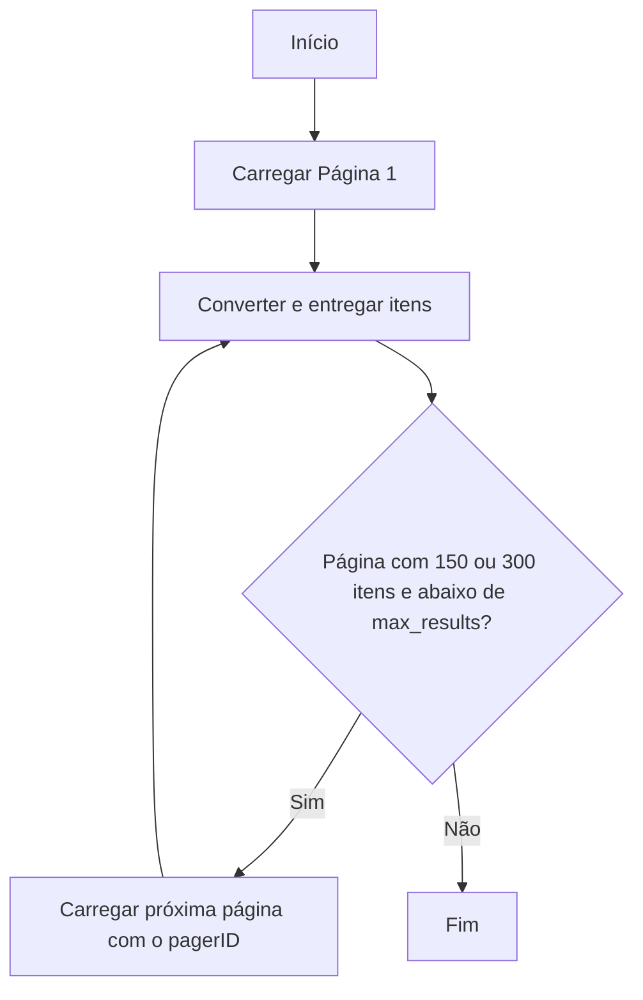
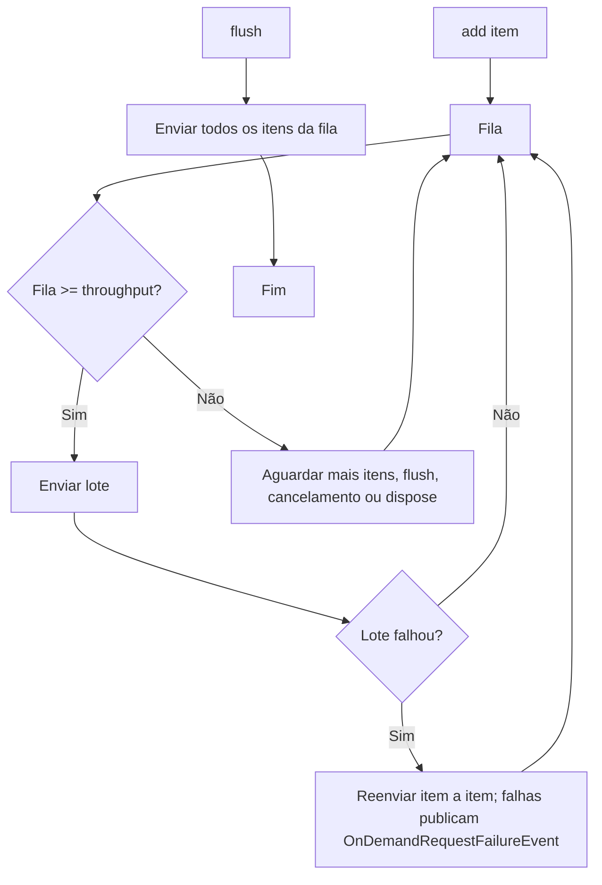

# Request Wrappers

Documentação dos wrappers de alto nível para operações com a API XML legada.

## Visão Geral

Os Request Wrappers abstraem operações complexas em interfaces simples:

| Wrapper | Uso |
|---------|-----|
| `SimpleCRUDRequestWrapper` | Operações CRUD básicas (métodos de classe) |
| `PagedRequestWrapper` | Consultas paginadas |
| `OnDemandRequestWrapper` / `OnDemandRequestFactory` | Processamento em lote em segundo plano |
| `AsyncOnDemandRequestWrapper` / `AsyncOnDemandRequestFactory` | Versão `asyncio` do processamento em lote |
| `KnowServicesRequestWrapper` | Serviços específicos (notas, faturamento, avisos, sessões, arquivos) |

```python
from sankhya_sdk.request_wrappers import (
    AsyncOnDemandRequestFactory,
    AsyncOnDemandRequestWrapper,
    KnowServicesRequestWrapper,
    OnDemandRequestFactory,
    OnDemandRequestWrapper,
    PagedRequestException,
    PagedRequestWrapper,
    SimpleCRUDRequestWrapper,
)
```

---

## SimpleCRUDRequestWrapper

Wrapper para operações CRUD básicas, porta do `SimpleCrudRequestWrapper`
estático do SDK .NET. Todos os métodos são **de classe** (não há instâncias
por contexto) e o estado (contexto e sessão) é compartilhado no processo.

### Uso Básico

```python
from sankhya_sdk import SankhyaContext
from sankhya_sdk.models.transport import Partner
from sankhya_sdk.request_wrappers import SimpleCRUDRequestWrapper

ctx = SankhyaContext.from_settings()
try:
    # Adquire uma sessão dedicada (um login extra)
    SimpleCRUDRequestWrapper.initialize(ctx)

    # Find
    partner = SimpleCRUDRequestWrapper.find(Partner(code=1))

    # Update
    partner.email_address = "novo@email.com"
    SimpleCRUDRequestWrapper.update(partner)

    # Insert (update sem chave primária)
    created = SimpleCRUDRequestWrapper.update(Partner(name="Novo Cliente"))

    # Remove
    SimpleCRUDRequestWrapper.remove(Partner(code=created.code))
finally:
    SimpleCRUDRequestWrapper.dispose()  # logout da sessão dedicada
    ctx.dispose()                       # logout das demais sessões
```

### Ciclo de Vida

#### `initialize(context=None) -> None`

Inicializa o wrapper. Com um contexto, **adquire uma sessão dedicada**
(`context.acquire_new_session(ServiceRequestType.SIMPLE_CRUD)`, um login
extra), como `Context.AcquireNewSession(ServiceRequestType.SimpleCrud)` no SDK
.NET: as operações do wrapper não usam a sessão principal do contexto. O
contexto continua pertencendo a quem o criou, que deve descartá-lo.

Sem contexto, cria um com `SankhyaContext.from_settings()` (dois logins: a
sessão principal desse contexto e a sessão dedicada). Esse contexto interno
pertence ao wrapper: `dispose()` encerra as duas sessões, sem afetar outros
contextos. `with SimpleCRUDRequestWrapper():` chama `initialize()` sem
contexto na entrada e `dispose()` na saída.

Thread-safe e idempotente: chamadas concorrentes adquirem uma única sessão, e
chamadas repetidas sem `dispose()` são ignoradas (com um aviso no log).

#### `dispose() -> None`

Finaliza a sessão dedicada (logout) e limpa o estado de classe. Com um
contexto informado em `initialize(ctx)`, não encerra a sessão principal dele
(use `ctx.dispose()`); com o contexto criado pelo próprio wrapper, encerra
também a sessão principal desse contexto. Pode ser chamado mais de uma vez.

### Métodos de Busca

As buscas recebem uma entidade de exemplo: os campos preenchidos (chave ou
não) viram o critério. As entidades da resposta chegam como `EntityDynamic`,
com os valores em texto bruto, e são convertidas para o tipo pedido por
`EntityDynamicSerialization.convert_to_type` (como no SDK .NET).

| Método | Retorno | Quando não encontra | Mais de um resultado |
|--------|---------|---------------------|----------------------|
| `try_find(entity, options=None)` | `T \| None` | `None` | `ServiceRequestTooManyResultsException` |
| `find(entity, options=None)` | `T` | `ServiceRequestUnexpectedResultException` (com `request` e `response`) | `ServiceRequestTooManyResultsException` |
| `find_all(entity, options=None)` | `list[T]` | lista vazia | - |
| `try_find_with_criteria(entity_type, criteria, options=None)` | `T \| None` | `None` | `ServiceRequestTooManyResultsException` |
| `find_with_criteria(entity_type, criteria, options=None)` | `T` | `ServiceRequestUnexpectedResultException` | `ServiceRequestTooManyResultsException` |

Versões assíncronas: `try_find_async`, `find_async`,
`try_find_async_with_criteria` e `find_async_with_criteria`.

```python
from sankhya_sdk.helpers import EntityQueryOptions, LiteralCriteria
from sankhya_sdk.models.transport import Partner
from sankhya_sdk.request_wrappers import SimpleCRUDRequestWrapper

# Pela chave
partner = SimpleCRUDRequestWrapper.try_find(Partner(code=1))

# Todos os ativos, no máximo 100
partners = SimpleCRUDRequestWrapper.find_all(
    Partner(is_active=True), EntityQueryOptions(max_results=100)
)

# Por critério literal
partner = SimpleCRUDRequestWrapper.try_find_with_criteria(
    Partner, LiteralCriteria.equals("CGC_CPF", "12345678000199")
)
```

| Parâmetro | Tipo | Descrição |
|-----------|------|-----------|
| `entity` | entidade (`EntityBase`) | Entidade de exemplo com os campos do critério |
| `entity_type` | `Type[T]` | Tipo da entidade (buscas com critério) |
| `criteria` | `ILiteralCriteria` | Critério (`sankhya_sdk.helpers.LiteralCriteria`) |
| `options` | `EntityQueryOptions \| None` | Limite de linhas, referências, campos de apresentação |

### Métodos de Escrita

#### `update(entity) -> T`

Envia `CRUDServiceProvider.saveRecord` com a chave e os campos preenchidos
da entidade e retorna a entidade devolvida pelo servidor. Sem chave
primária, o servidor cria o registro (não existe `insert`). Versão
assíncrona: `update_async`.

```python
from sankhya_sdk.models.transport import Partner
from sankhya_sdk.request_wrappers import SimpleCRUDRequestWrapper

updated = SimpleCRUDRequestWrapper.update(Partner(code=1, email_address="novo@email.com"))
created = SimpleCRUDRequestWrapper.update(Partner(name="Novo Cliente"))
print(created.code)  # Código gerado
```

`saveRecord` é um serviço transacional: sessão duplicada, deadlock e timeout
não são repetidos automaticamente (veja
[Tratamento de Erros](../core-concepts/error-handling.md#servicos-transacionais)).

#### `remove(entity) -> None`

Envia `CRUDServiceProvider.removeRecord` com a chave da entidade. Não há
valor de retorno: erros do servidor viram exceções. Versão assíncrona:
`remove_async`.

```python
from sankhya_sdk.models.transport import Partner
from sankhya_sdk.request_wrappers import SimpleCRUDRequestWrapper

SimpleCRUDRequestWrapper.remove(Partner(code=999))
```

---

## PagedRequestWrapper

Wrapper para consultas paginadas com grandes volumes de dados. As páginas são
carregadas numa thread separada enquanto o generator devolve os itens já
convertidos para o tipo informado.

### Uso Básico

```python
from sankhya_sdk import SankhyaContext
from sankhya_sdk.enums import ServiceName
from sankhya_sdk.helpers import LiteralCriteria, ServiceRequestExtensions
from sankhya_sdk.models.service import ServiceRequest
from sankhya_sdk.models.transport import Partner
from sankhya_sdk.request_wrappers import PagedRequestWrapper

request = ServiceRequest(service=ServiceName.CRUD_SERVICE_FIND)
ServiceRequestExtensions.resolve_with_literal_criteria(
    request, Partner, LiteralCriteria("ATIVO = 'S'")
)

ctx = SankhyaContext.from_settings()
try:
    # Itera sobre resultados paginados (usa a sessão de ctx.token)
    for partner in PagedRequestWrapper.get_paged_results(request, Partner, ctx.token):
        print(partner.name)
finally:
    ctx.dispose()
```

### Fluxo de Paginação



Como no SDK .NET, só a quantidade de itens da página (150 ou 300 indicam que
há mais) e `max_results` encerram a paginação; o `totalPages` da resposta é
apenas informativo (eventos de progresso).

### Métodos

#### `get_paged_results(request, entity_type, token, ...) -> Generator[T]`

Método de classe; retorna um generator síncrono.

```python
from datetime import timedelta

from sankhya_sdk.models.transport import Partner
from sankhya_sdk.request_wrappers import PagedRequestWrapper

for partner in PagedRequestWrapper.get_paged_results(
    request,
    Partner,
    ctx.token,
    timeout=timedelta(minutes=10),
    max_results=1000,
):
    print(partner.code)
```

| Parâmetro | Tipo | Padrão | Descrição |
|-----------|------|--------|-----------|
| `request` | `ServiceRequest` | - | Requisição `CRUDServiceProvider.loadRecords` já resolvida |
| `entity_type` | `Type[T]` | - | Tipo da entidade retornada |
| `token` | `uuid.UUID` | - | Token da sessão (`ctx.token` ou `ctx.acquire_new_session()`) |
| `timeout` | `timedelta` | 5 minutos | Tempo total da iteração, contado desde o início e verificado enquanto aguarda a próxima página; excedido, lança `TimeoutError` |
| `process_data` | `Callable[[list[T]], None] \| None` | `None` | Recebe cada página já convertida (e cortada em `max_results`) antes que os itens dela sejam entregues; se lançar exceção, os itens da página não são entregues e a exceção é propagada |
| `max_results` | `int` | `-1` | Limite total (-1 = sem limite) |
| `on_page_loaded` | `Callable[[PagedRequestEventArgs], None] \| None` | `None` | Página carregada |
| `on_page_error` | `Callable[[PagedRequestEventArgs], None] \| None` | `None` | Erro ao carregar página |
| `on_page_processed` | `Callable[[PagedRequestEventArgs], None] \| None` | `None` | Página processada |

Erros de carregamento são relançados como `PagedRequestException` (veja
[Exceções](exceptions.md#pagedrequestexception)).

#### `get_paged_results_async(request, entity_type, token, ...) -> AsyncGenerator[T]`

Versão assíncrona, com os mesmos parâmetros; aqui `process_data` deve ser
uma função assíncrona (`async def`), aguardada a cada página.

```python
import asyncio

from sankhya_sdk.models.transport import Partner
from sankhya_sdk.request_wrappers import PagedRequestWrapper


async def main() -> None:
    async for partner in PagedRequestWrapper.get_paged_results_async(
        request, Partner, ctx.token
    ):
        print(partner.name)

asyncio.run(main())
```

### Callbacks

```python
from sankhya_sdk.models.transport import Partner
from sankhya_sdk.request_wrappers import PagedRequestWrapper
from sankhya_sdk.value_objects import PagedRequestEventArgs


def on_page_loaded(args: PagedRequestEventArgs) -> None:
    print(f"Página {args.current_page}/{args.total_pages or '?'}")
    print(f"Itens: {args.quantity_loaded} (total {args.total_loaded})")


def on_error(args: PagedRequestEventArgs) -> None:
    print(f"Erro na página {args.current_page}: {args.exception}")


partners = list(PagedRequestWrapper.get_paged_results(
    request,
    Partner,
    ctx.token,
    on_page_loaded=on_page_loaded,
    on_page_error=on_error,
))
```

---

## OnDemandRequestWrapper

Wrapper para processamento em lote com fila: as entidades adicionadas são
enviadas por uma thread em segundo plano, em lotes, com o serviço informado
(ex.: `CRUD_SERVICE_SAVE` ou `CRUD_SERVICE_REMOVE`). Se um lote falha, as
entidades são reenviadas uma a uma, e cada falha publica um
`OnDemandRequestFailureEvent` no `EventBus`.

### Uso Básico

O jeito recomendado de criar o wrapper é a `OnDemandRequestFactory`, que
adquire uma sessão dedicada (`ON_DEMAND_CRUD`) do contexto e a finaliza
quando o worker termina:

```python
import threading

from sankhya_sdk import SankhyaContext
from sankhya_sdk.enums import ServiceName
from sankhya_sdk.models.transport import Partner
from sankhya_sdk.request_wrappers import OnDemandRequestFactory

partners = [Partner(code=i, is_active=True) for i in range(1, 101)]

ctx = SankhyaContext.from_settings()
cancel = threading.Event()
key = OnDemandRequestFactory.create_instance(
    Partner,
    ServiceName.CRUD_SERVICE_SAVE,
    cancel,
    context=ctx,
    throughput=10,  # Envia um lote a cada 10 entidades na fila
)
try:
    on_demand = OnDemandRequestFactory.get_instance_by_key(key)
    assert on_demand is not None

    # Adiciona itens à fila
    for partner in partners:
        on_demand.add(partner)

    # Envia o que restou na fila e aguarda
    on_demand.flush()
finally:
    OnDemandRequestFactory.finalize_by_key(key)  # dispose do wrapper
    ctx.dispose()
```

### Fluxo de Processamento



### Construtor

O construtor também pode ser usado diretamente, informando o contexto e o
token de uma sessão:

```python
import threading

from sankhya_sdk import SankhyaContext
from sankhya_sdk.enums import ServiceName, ServiceRequestType
from sankhya_sdk.models.transport import Partner
from sankhya_sdk.request_wrappers import OnDemandRequestWrapper

ctx = SankhyaContext.from_settings()
token = ctx.acquire_new_session(ServiceRequestType.ON_DEMAND_CRUD)

on_demand: OnDemandRequestWrapper[Partner] = OnDemandRequestWrapper(
    ServiceName.CRUD_SERVICE_SAVE,
    threading.Event(),            # Cancelamento
    throughput=10,                # Itens por lote
    allow_above_throughput=True,  # Lote leva tudo o que estiver na fila
    context=ctx,
    session_token=token,
    owns_session=True,            # Finaliza a sessão quando o worker termina
)
with on_demand:  # flush() e dispose() na saída
    on_demand.add(Partner(code=1, is_active=True))

ctx.dispose()
```

### Métodos e Propriedades

| Membro | Descrição |
|--------|-----------|
| `add(entity)` | Adiciona à fila (`CanceledOnDemandRequestWrapperException` após cancelamento, `ValueError` após `dispose`) |
| `flush()` | Envia o que está na fila e aguarda o processamento das entidades adicionadas antes da chamada (veja abaixo) |
| `dispose()` | Encerra o worker (envia o restante da fila antes) e aguarda até 30 s por ele |
| `request_count`, `entities_sent`, `entities_sent_successfully`, `queue_size`, `is_disposed` | Estatísticas e estado |

O cancelamento é feito pelo `threading.Event` informado na criação
(`cancel.set()`): o worker envia o que já está na fila e termina.

#### `flush()`

Aguarda até que todas as entidades adicionadas **antes** da chamada tenham
sido processadas (com sucesso ou não), inclusive as de um lote que o worker
já está enviando. Cada chamada aguarda o próprio alvo: um `flush()`
concorrente de outra thread não a libera antes da hora, e entidades
adicionadas depois da chamada não a prendem. Se o worker já terminou (ex.:
após cancelamento), retorna sem aguardar.

Chamado na própria thread worker, como num handler de
`OnDemandRequestFailureEvent`, o `flush()` apenas solicita o envio da fila e
retorna sem aguardar (aguardar ali travaria o wrapper).

#### Descarte pelo contexto

`SankhyaContext.dispose()` (ou a saída de `with ctx:`), quando o contexto
tem sessões on-demand, chama antes `OnDemandRequestFactory.finalize_all()`:
**todos** os wrappers da factory, de qualquer contexto (como o `FinalizeAll`
do .NET), enviam o restante da fila e liberam as próprias sessões antes que
as sessões sejam encerradas. Para finalizar só um wrapper, use
`OnDemandRequestFactory.finalize_by_key(key)`.

### Falhas

Timeout e deadlock são repetidos uma vez, sem espera. Se o lote falha, cada
entidade é reenviada sozinha, e as que falharem de novo geram
`OnDemandRequestFailureEvent`, publicado na thread worker. `is_update` é
`True` quando o serviço é `CRUD_SERVICE_SAVE` e `False` para os demais (ex.:
`CRUD_SERVICE_REMOVE`), como no .NET (veja [Eventos](events.md)):

```python
from sankhya_sdk.events import EventBus, OnDemandRequestFailureEvent


def on_failure(event: OnDemandRequestFailureEvent) -> None:
    operacao = "gravação" if event.is_update else "remoção"
    print(f"Falha na {operacao} de {event.entity}: {event.exception}")


EventBus.subscribe(OnDemandRequestFailureEvent, on_failure)
```

---

## KnowServicesRequestWrapper

Wrapper (métodos de classe) para serviços específicos: notas, faturamento,
avisos e mensagens, sessões e arquivos.

`initialize(ctx)` usa a **sessão principal** do contexto (sem login extra), e
`dispose()` não a encerra (ela pertence ao contexto). `initialize()` sem
contexto cria um contexto, que pertence ao wrapper, e adquire dele uma sessão
própria (`KNOW_SERVICES`); `dispose()` encerra as duas sessões. Como no
`SimpleCRUDRequestWrapper`, a inicialização é thread-safe e idempotente.

!!! note "Divergência do SDK .NET"
    No .NET a classe sempre adquire uma sessão própria
    (`Context.AcquireNewSession(ServiceRequestType.KnowServices)`). Nesta
    versão, `initialize(ctx)` ainda reaproveita a sessão principal do
    contexto: as chamadas do wrapper não ficam isoladas numa sessão própria.

### Uso Básico

```python
from sankhya_sdk import SankhyaContext
from sankhya_sdk.enums import BillingType
from sankhya_sdk.request_wrappers import KnowServicesRequestWrapper

ctx = SankhyaContext.from_settings()
try:
    KnowServicesRequestWrapper.initialize(ctx)

    # Faturar nota
    nunota, events = KnowServicesRequestWrapper.bill(
        single_number=12345,
        code_operation_type=1100,
        billing_type=BillingType.NORMAL,
    )

    # Confirmar nota
    KnowServicesRequestWrapper.confirm_invoice(single_number=12345)
finally:
    KnowServicesRequestWrapper.dispose()
    ctx.dispose()
```

Os exemplos a seguir assumem o wrapper inicializado.

### Sessões, Avisos e Mensagens

```python
from sankhya_sdk.enums import SankhyaWarningLevel
from sankhya_sdk.models.service import SystemWarningRecipient
from sankhya_sdk.request_wrappers import KnowServicesRequestWrapper

# Sessões ativas no servidor
for session in KnowServicesRequestWrapper.get_sessions():
    print(session.session_id, session.user_name)

# Aviso do sistema
KnowServicesRequestWrapper.send_warning(
    title="Título",
    description="Texto do aviso",
    level=SankhyaWarningLevel.WARNING,
    recipients=[SystemWarningRecipient(user_id=1)],
)

# Mensagem interna
KnowServicesRequestWrapper.send_message(
    content="Texto da mensagem",
    recipients=[SystemWarningRecipient(user_id=1), SystemWarningRecipient(user_id=2)],
)
```

Também há `kill_session(session_id)` e `receive_messages()`.

### Métodos de Nota Fiscal

| Método | Retorno | Descrição |
|--------|---------|-----------|
| `create_invoice(invoice_header, invoice_items=None)` | `int` | Inclui nota (NUNOTA) |
| `add_invoice_items(single_number, invoice_items)` | `int` | Inclui itens |
| `remove_invoice(single_number)` / `remove_invoice_items(items)` | `None` | Exclui nota/itens |
| `bill(single_number, code_operation_type, billing_type, series=None, request_events=None)` | `(int, list[ClientEvent] \| None)` | Fatura |
| `confirm_invoice(single_number)` | `None` | Confirma |
| `duplicate_invoice(single_number, code_operation_type, series=None, date_exit=None, should_update_price=False)` | `int` | Duplica (NUNOTA da nova nota) |
| `cancel_invoices(single_numbers, justification)` | `(int, list[int])` | Cancela (quantidade, não canceladas) |
| `flag_invoices_as_not_pending(single_numbers)` | `None` | Marca pedidos como não pendentes |
| `get_invoice_accompaniments(single_numbers)` | `list[Invoice]` | Acompanhamentos |
| `bind_invoice_with_order(single_number, code_partner, movement_type)` | `None` | Liga pedido à nota |

```python
from sankhya_sdk.request_wrappers import KnowServicesRequestWrapper

cancelled, not_cancelled = KnowServicesRequestWrapper.cancel_invoices(
    single_numbers=[12345],
    justification="Motivo do cancelamento",
)

new_note = KnowServicesRequestWrapper.duplicate_invoice(
    single_number=12345,
    code_operation_type=1100,
)
```

### Métodos de NF-e e Financeiro

| Método | Descrição |
|--------|-----------|
| `generate_lot(single_numbers)` | Gera o lote de NF-e (`ServicosNfeSP.gerarLote`) |
| `get_fiscal_invoice_authorization(single_numbers)` | Consulta o processamento do lote (`ServicosNfeSP.buscaProcessamentoLote`) |
| `flag_as_payments_paid(financial_numbers, code_account)` | Baixa títulos |
| `reverse_payments(financial_numbers)` | Estorna baixas |
| `unlink_shipping(financial_number)` | Desvincula remessa |

```python
from sankhya_sdk.request_wrappers import KnowServicesRequestWrapper

KnowServicesRequestWrapper.generate_lot([12345])
KnowServicesRequestWrapper.get_fiscal_invoice_authorization([12345])
```

### Métodos de Arquivo/Imagem

| Método | Retorno | Descrição |
|--------|---------|-----------|
| `open_file(path)` | `str` | Abre um arquivo do repositório e retorna a chave |
| `get_file(key)` / `get_file_async(key)` | `ServiceFile` | Baixa o arquivo pela chave |
| `get_image(entity)` / `get_image_async(entity)` | `ServiceFile \| None` | Baixa a imagem de uma entidade (`None` se não houver) |
| `delete_files(paths)` | `None` | Remove arquivos do repositório |

`get_image` recebe uma instância da entidade com a chave primária preenchida
(ex.: `Product(code=100)`) e resolve dela o nome da entidade (`"Produto"`) e
as chaves (`{"CODPROD": "100"}`), como o `GetImage` do .NET; a imagem é
baixada com a sessão principal do contexto. O `ServiceFile` retornado
(`sankhya_sdk.core.types.ServiceFile`) tem `data`, `content_type`,
`file_extension` e `filename`.

```python
from sankhya_sdk.models.transport import Product
from sankhya_sdk.request_wrappers import KnowServicesRequestWrapper

key = KnowServicesRequestWrapper.open_file("/Repositorio/relatorio.pdf")
file = KnowServicesRequestWrapper.get_file(key)
print(file.filename, file.content_type, len(file.data))

image = KnowServicesRequestWrapper.get_image(Product(code=100))
if image is not None:
    with open(f"produto_100.{image.file_extension}", "wb") as f:
        f.write(image.data)
```

---

## Async

Não existem `AsyncSankhyaContext` nem `AsyncSimpleCRUDRequestWrapper`: o
`SankhyaContext` suporta `async with` e o `SimpleCRUDRequestWrapper` tem os
métodos `*_async`. Para lotes há o `AsyncOnDemandRequestWrapper`, cujos
métodos são corrotinas, com a mesma semântica de `flush()` da versão
síncrona.

!!! warning "Descarte de wrappers assíncronos"
    `ctx.dispose()` é síncrono e não aguarda os `AsyncOnDemandRequestWrapper`.
    Use `async with ctx:` (a saída aguarda
    `AsyncOnDemandRequestFactory.finalize_all()` antes do `dispose()`) ou
    aguarde `AsyncOnDemandRequestFactory.finalize_by_key(key)` antes de
    `ctx.dispose()`.

### AsyncOnDemandRequestWrapper

```python
import asyncio

from sankhya_sdk import SankhyaContext
from sankhya_sdk.enums import ServiceName
from sankhya_sdk.models.transport import Partner
from sankhya_sdk.request_wrappers import AsyncOnDemandRequestFactory


async def main() -> None:
    partners = [Partner(code=i, is_active=True) for i in range(1, 51)]
    ctx = SankhyaContext.from_settings()
    # A saída do async with aguarda os wrappers assíncronos e chama dispose()
    async with ctx:
        key = await AsyncOnDemandRequestFactory.create_instance(
            Partner, ServiceName.CRUD_SERVICE_SAVE, asyncio.Event(), context=ctx
        )
        on_demand = await AsyncOnDemandRequestFactory.get_instance_by_key(key)
        assert on_demand is not None

        for partner in partners:
            await on_demand.add(partner)

        await on_demand.flush()

asyncio.run(main())
```

## Próximos Passos

- [Helpers](helpers.md) - Utilitários auxiliares
- [Core](core.md) - Classes principais
- [Exemplos](../examples/index.md) - Exemplos práticos
