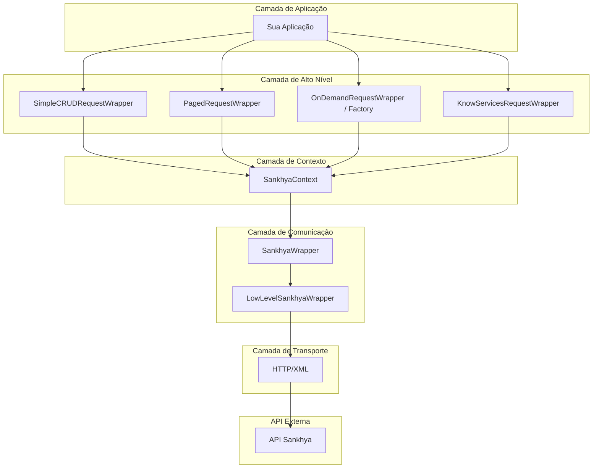
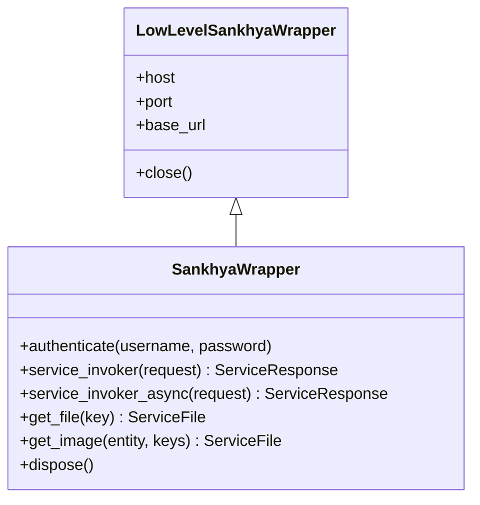
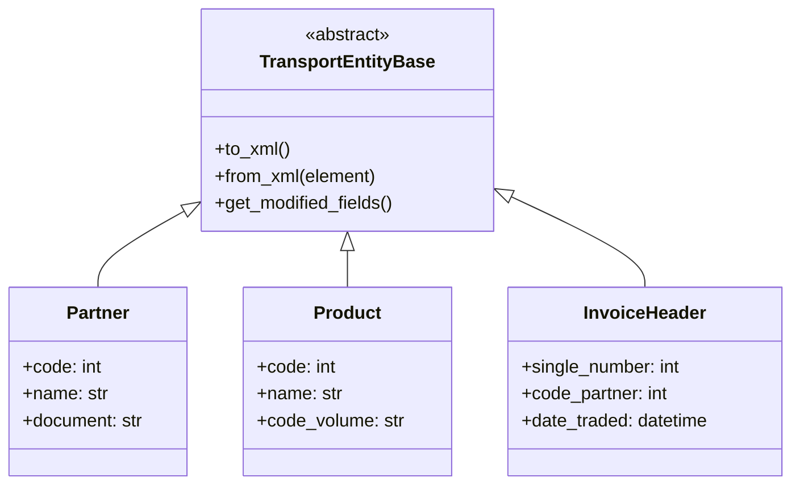
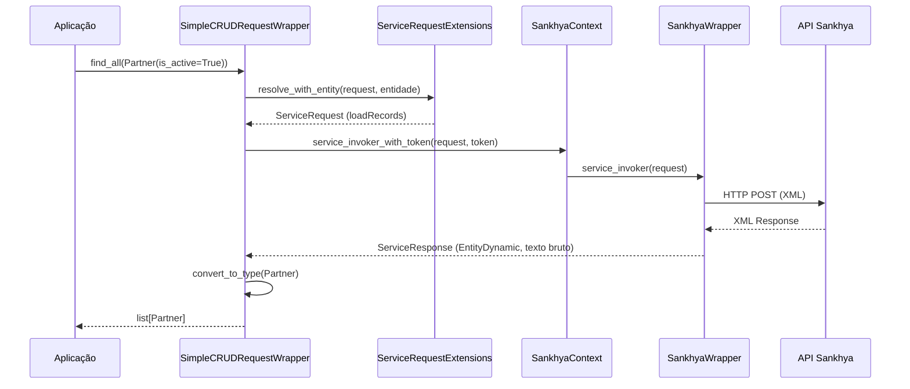
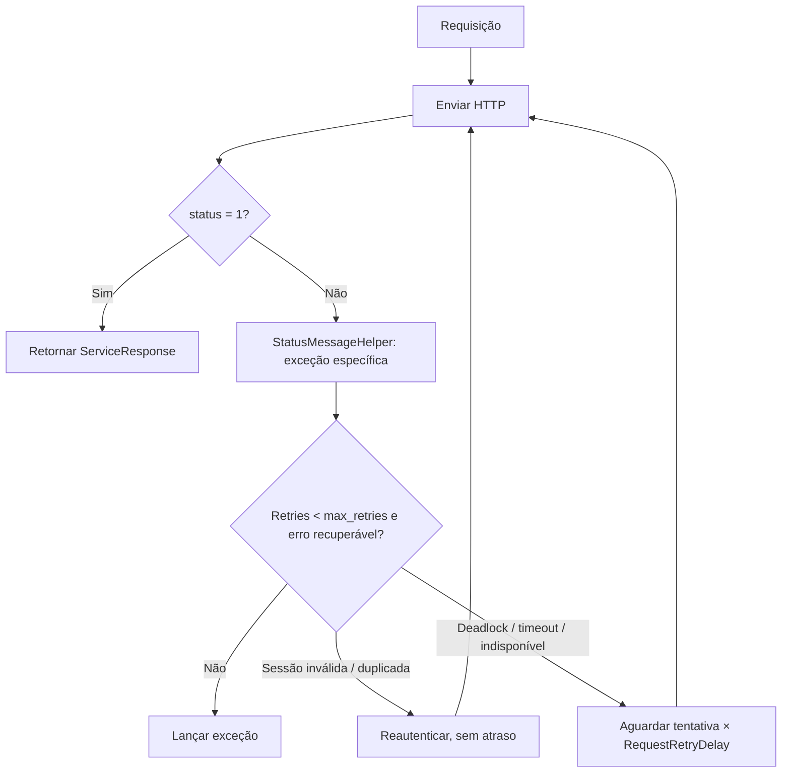

# Arquitetura

Este documento descreve a arquitetura da API XML legada do Sankhya SDK
Python (porta do SDK .NET), seus componentes e como eles se integram. A API
JSON (Gateway/OAuth) é descrita em [Gateway Client](../api-reference/gateway-client.md).

## Visão Geral da Arquitetura

O SDK segue uma arquitetura em camadas, onde cada camada tem
responsabilidades bem definidas:



## Componentes Principais

### 1. Request Wrappers (Camada de Alto Nível)

Abstrações de alto nível que simplificam operações comuns:

| Wrapper | Responsabilidade |
|---------|------------------|
| `SimpleCRUDRequestWrapper` | Find, Update (inclui ou altera) e Remove, em uma sessão dedicada |
| `PagedRequestWrapper` | Consultas paginadas para grandes volumes de dados |
| `OnDemandRequestWrapper` / `OnDemandRequestFactory` | Gravação e remoção em lote em segundo plano |
| `AsyncOnDemandRequestWrapper` / `AsyncOnDemandRequestFactory` | Versão `asyncio` do processamento em lote |
| `KnowServicesRequestWrapper` | Serviços específicos (notas, NF-e, financeiro, avisos, arquivos) |

```python
from sankhya_sdk.request_wrappers import (
    KnowServicesRequestWrapper,
    OnDemandRequestFactory,
    OnDemandRequestWrapper,
    PagedRequestWrapper,
    SimpleCRUDRequestWrapper,
)
```

Os wrappers `SimpleCRUD` e `KnowServices` são usados pelos métodos de
classe (estado compartilhado no processo, como as classes estáticas do
.NET). Veja [Request Wrappers](../api-reference/request-wrappers.md).

### 2. SankhyaContext (Camada de Contexto)

Gerenciador central de sessões e ciclo de vida:

```python
from sankhya_sdk import SankhyaContext
from sankhya_sdk.enums import ServiceRequestType

ctx = SankhyaContext.from_settings()  # Login da sessão principal
try:
    # ctx gerencia:
    # - a sessão principal (ctx.token, ctx.wrapper)
    # - sessões adicionais, identificadas por token
    # - o descarte das sessões (logout)
    token = ctx.acquire_new_session(ServiceRequestType.DEFAULT)
    ctx.finalize_session(token)
finally:
    ctx.dispose()
```

**Responsabilidades:**

- Sessão principal e sessões adicionais (`acquire_new_session`)
- Registro de classe dos wrappers por token
- Invocação de serviços com um token (`service_invoker_with_token`)
- Descarte das sessões (`dispose()`, `with`/`async with`)

### 3. SankhyaWrapper (Camada de Comunicação)

Cliente de uma sessão da API:



**Responsabilidades:**

- Login (com o registro do User-Agent via DWR) e logout
- Serialização/deserialização XML dos `ServiceRequest`/`ServiceResponse`
- Tradução da `statusMessage` (decodificada de Base64) em exceções
- Retry automático com atraso linear (`tentativa × RequestRetryDelay`), como
  no SDK .NET (veja [Tratamento de Erros](error-handling.md#retry-automatico))
- Cookie de sessão (`JSESSIONID`) e reautenticação

### 4. Modelos e Entidades



As entidades (`sankhya_sdk.models.transport`) são modelos Pydantic; os
modelos de serviço (`sankhya_sdk.models.service`) representam o XML das
requisições e respostas. Veja [Sistema de Entidades](entity-system.md).

## Fluxo de Dados

### Requisição



### Tratamento de Erros



Em serviços transacionais (ex.: `saveRecord`), sessão duplicada, deadlock e
timeout não são repetidos.

## Padrões de Design

### 1. Context Manager

O SDK usa context managers para gerenciamento de recursos:

```python
from sankhya_sdk import SankhyaContext

# O with entrega o SankhyaWrapper da sessão principal e chama dispose()
with SankhyaContext.from_settings() as wrapper:
    print(wrapper.session_id)
```

### 2. Factory Pattern

Criação de contextos, sessões e wrappers:

```python
import threading

from sankhya_sdk import SankhyaContext
from sankhya_sdk.enums import ServiceName, ServiceRequestType
from sankhya_sdk.models.transport import Partner
from sankhya_sdk.request_wrappers import OnDemandRequestFactory

ctx = SankhyaContext.from_settings()                   # Factory method
try:
    token = ctx.acquire_new_session(ServiceRequestType.DEFAULT)  # Sessões
    ctx.finalize_session(token)

    key = OnDemandRequestFactory.create_instance(       # Wrappers on-demand
        Partner, ServiceName.CRUD_SERVICE_SAVE, threading.Event(), context=ctx
    )
    OnDemandRequestFactory.finalize_by_key(key)
finally:
    ctx.dispose()
```

### 3. Política de Retry

A política de retry é fixa, como no `SankhyaWrapper` do .NET; o único
ajuste é o número máximo de repetições:

```python
from sankhya_sdk import SankhyaWrapper
from sankhya_sdk.request_helpers import RequestRetryDelay

# Atrasos-base, em segundos, multiplicados pelo número da tentativa
print(RequestRetryDelay.FREE, RequestRetryDelay.STABLE)  # 10 15

# Máximo de repetições (padrão 3; ou a variável SANKHYA_MAX_RETRIES)
wrapper = SankhyaWrapper(host="http://sankhya.example.com", port=8180, max_retries=5)
```

`RequestBehaviorOptions` (`sankhya_sdk.request_helpers`) existe por
paridade com o .NET, mas não é lido pelo `SankhyaWrapper`.

### 4. Metadados de Entidade

Decorador de classe e funções de campo:

```python
from typing import Optional

from sankhya_sdk.attributes import entity, entity_element, entity_key
from sankhya_sdk.models.transport import TransportEntityBase


@entity("Parceiro")
class MeuParceiro(TransportEntityBase):
    code: Optional[int] = entity_key(entity_element("CODPARC", default=None))
    name: Optional[str] = entity_element("NOMEPARC", default=None)
```

### 5. Observer Pattern

Callbacks em operações paginadas e eventos de falha on-demand:

```python
from sankhya_sdk.events import EventBus, OnDemandRequestFailureEvent
from sankhya_sdk.value_objects import PagedRequestEventArgs


def on_page_loaded(args: PagedRequestEventArgs) -> None:
    print(f"Página {args.current_page} carregada")


def on_failure(event: OnDemandRequestFailureEvent) -> None:
    print(f"Falha em {event.entity}: {event.exception}")


# PagedRequestWrapper.get_paged_results(..., on_page_loaded=on_page_loaded)
EventBus.subscribe(OnDemandRequestFailureEvent, on_failure)
```

## Estrutura de Diretórios

```
sankhya_sdk/
├── __init__.py                # Exports principais
├── config.py                  # SankhyaSettings (variáveis SANKHYA_*)
├── core/
│   ├── context.py             # SankhyaContext
│   ├── wrapper.py             # SankhyaWrapper (retry, arquivos, imagens)
│   ├── low_level_wrapper.py   # LowLevelSankhyaWrapper (HTTP)
│   ├── lock_manager.py        # LockManager
│   ├── constants.py           # Constantes
│   └── types.py               # SessionInfo, ServiceFile, ServiceAttribute
├── attributes/                # @entity, entity_key, entity_element...
├── enums/                     # ServiceName, ServiceRequestType...
├── events/                    # EventBus, OnDemandRequestFailureEvent
├── exceptions/                # Hierarquia de exceções
├── helpers/
│   ├── entity_dynamic_serialization.py  # convert_to_type
│   ├── entity_extensions.py             # extract_keys, get_entity_name
│   ├── entity_query_options.py          # EntityQueryOptions
│   ├── filter_expression.py             # LiteralCriteria
│   ├── service_request_extensions.py    # resolve_*
│   └── status_message_helper.py         # statusMessage -> exceção
├── models/
│   ├── service/               # ServiceRequest, ServiceResponse, DataSet...
│   ├── transport/             # Partner, Product, InvoiceHeader...
│   └── dtos/                  # DTOs da API Gateway
├── request_helpers/           # RequestRetryDelay, RequestRetryData...
├── request_wrappers/
│   ├── simple_crud_request_wrapper.py
│   ├── paged_request_wrapper.py
│   ├── on_demand_request_wrapper.py / on_demand_request_factory.py
│   ├── async_on_demand_request_wrapper.py / async_on_demand_request_factory.py
│   └── know_services_request_wrapper.py
├── validations/               # EntityValidator, EntityValidation
├── value_objects/             # PagedRequestEventArgs, ServiceFile...
├── auth/, http/, adapters/    # API Gateway (OAuth, GatewayClient, XmlAdapter)
```

## Extensibilidade

### Criando Entidades Customizadas

```python
from decimal import Decimal
from typing import Optional

from sankhya_sdk.attributes import entity, entity_element, entity_key
from sankhya_sdk.models.transport import TransportEntityBase


@entity("AD_MEUCAMPO")
class MinhaEntidade(TransportEntityBase):
    id_campo: Optional[int] = entity_key(entity_element("IDCAMPO", default=None))
    descricao: Optional[str] = entity_element("DESCRICAO", default=None)
    valor: Optional[Decimal] = entity_element("VALOR", default=None)
```

Veja [Entidades Customizadas](../examples/custom-entities.md).

### Chamando Serviços sem Wrapper

Para um serviço sem wrapper de alto nível, monte o `ServiceRequest` e
invoque-o pelo contexto (ou por um token):

```python
from sankhya_sdk import SankhyaContext
from sankhya_sdk.enums import ServiceName
from sankhya_sdk.models.service import ServiceRequest

request = ServiceRequest(service=ServiceName.SESSION_GET_ALL)

ctx = SankhyaContext.from_settings()
try:
    response = ctx.service_invoker(request)
    # ou: SankhyaContext.service_invoker_with_token(request, token)
    print(response.is_success)
finally:
    ctx.dispose()
```

Os serviços disponíveis são os membros de `ServiceName` (veja
[Enumerações](../api-reference/enums.md#servicename)).

## Considerações de Performance

### Conexões HTTP

- Uma `requests.Session` por `SankhyaWrapper` (keep-alive)
- Timeout configurável (`SANKHYA_TIMEOUT`, padrão 30 s)
- Chamadas de uma mesma sessão são serializadas por um lock; para
  paralelismo, use sessões adicionais (`acquire_new_session`)

### Serialização XML

- lxml para montar e ler o XML

### Grandes Volumes de Dados

- Use `PagedRequestWrapper` para consultas grandes
- Use `OnDemandRequestFactory` para gravação/remoção em lote
- Configure `max_results` apropriadamente

## Próximos Passos

- [Gerenciamento de Sessões](session-management.md) - Detalhes sobre sessões
- [Sistema de Entidades](entity-system.md) - Criação de entidades
- [Tratamento de Erros](error-handling.md) - Estratégias de erro
