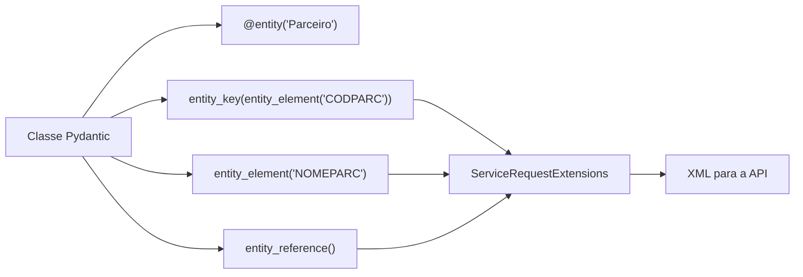
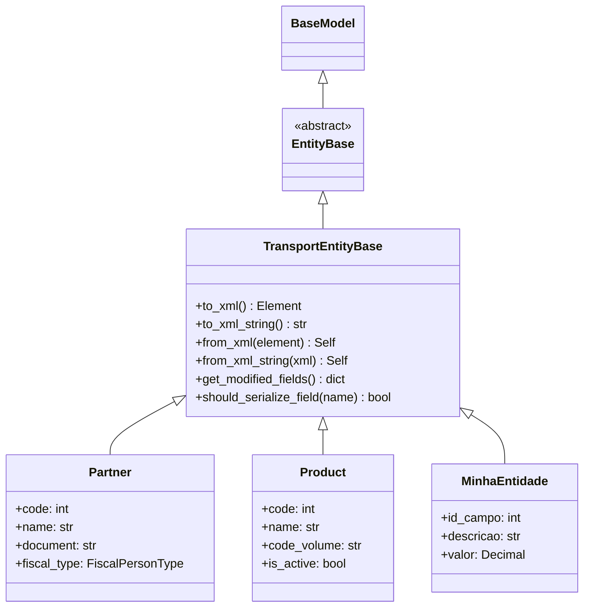
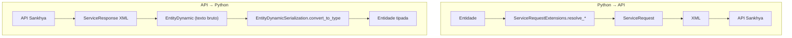

# Sistema de Entidades

Este documento explica o sistema de entidades da API XML legada: o
decorador `@entity`, os metadados de campo, a serialização XML e a criação
de entidades customizadas.

## Visão Geral

As entidades são modelos Pydantic que herdam de `TransportEntityBase`
(`sankhya_sdk.models.transport`). O decorador `@entity` define o nome da
entidade no Sankhya, e cada campo declara seus metadados com funções que
retornam um `pydantic.Field` (não são decoradores de método):



## Metadados

### @entity

Define o nome da entidade na API (`rootEntity`). Só pode ser aplicado a
subclasses de `pydantic.BaseModel`:

```python
from typing import Optional

from sankhya_sdk.attributes import entity, entity_element, entity_key
from sankhya_sdk.models.transport import TransportEntityBase


@entity("Parceiro")
class MeuParceiro(TransportEntityBase):
    code: Optional[int] = entity_key(entity_element("CODPARC", default=None))
```

| Parâmetro | Tipo | Descrição |
|-----------|------|-----------|
| `name` | `str` | Nome da entidade no Sankhya (ex.: `"Parceiro"`, `"AD_CONTATO"`) |

### Funções de Campo

| Função | Descrição |
|--------|-----------|
| `entity_element(element_name, ignore_inline_reference=False, **kwargs)` | Campo com o nome do elemento na API; `kwargs` vão para o `pydantic.Field` (ex.: `default=None`) |
| `entity_key(field)` | Marca o campo como chave primária: `entity_key(entity_element("CODPARC", default=None))` |
| `entity_reference(custom_relation_name=None, **kwargs)` | Referência a outra entidade (`<entity path="...">` nas buscas); o nome da relação é o da entidade referenciada ou `custom_relation_name` |
| `entity_ignore(**kwargs)` | Campo fora da API: não é enviado nem buscado e fica fora de `model_dump()` |
| `entity_custom_data(max_length=None, field=...)` | Limite de tamanho validado na criação e na atribuição |

```python
from typing import Optional

from sankhya_sdk.attributes import (
    entity,
    entity_custom_data,
    entity_element,
    entity_ignore,
    entity_key,
    entity_reference,
)
from sankhya_sdk.models.transport import Partner, TransportEntityBase


@entity("AD_CONTATO")
class Contato(TransportEntityBase):
    id_contato: Optional[int] = entity_key(entity_element("IDCONTATO", default=None))
    code_partner: Optional[int] = entity_element("CODPARC", default=None)
    nome: Optional[str] = entity_custom_data(
        max_length=60, field=entity_element("NOME", default=None)
    )
    email: Optional[str] = entity_element("EMAIL", default=None)

    # Referência para a entidade Parceiro
    parceiro: Optional[Partner] = entity_reference(default=None)

    # Só existe no Python
    observacao_local: Optional[str] = entity_ignore(default=None)
```

!!! warning "Elementos com `_` são referências inline"
    Como no SDK .NET, um nome de elemento no formato `ENTIDADE_CAMPO` é
    tratado como referência inline (campo `CAMPO` da entidade `ENTIDADE`),
    exceto quando começa com `AD` (campos customizados `AD_*`). Para um
    campo comum com `_` no nome (ex.: `CGC_CPF` do `Partner`), use
    `entity_element("CGC_CPF", ignore_inline_reference=True, default=None)`.

## Entidades Pré-definidas

O SDK inclui entidades prontas: `Partner`, `Product`, `InvoiceHeader`,
`Address`, `City`, `State`, `Region`, `Neighborhood`, `PartnerComplement`,
`Seller`, `ProductCost`, `CodeBars`, `ProductSuggestedSale` e `ServiceFile`
(campos em [Modelos](../api-reference/models.md#campos)).

```python
from datetime import datetime

from sankhya_sdk.models.transport import InvoiceHeader, Partner, Product

partner = Partner(code=1, name="Cliente LTDA", document="12345678000199", is_client=True)

product = Product(code=100, name="Produto Exemplo", code_volume="UN", is_active=True)

header = InvoiceHeader(
    single_number=12345, code_partner=1, code_company=1, date_traded=datetime.now()
)
```

## Criando Entidades Customizadas

### Exemplo Básico

```python
from decimal import Decimal
from typing import Optional

from sankhya_sdk.attributes import entity, entity_element, entity_key
from sankhya_sdk.models.transport import TransportEntityBase


@entity("AD_MEUCAMPO")
class MinhaEntidade(TransportEntityBase):
    """Entidade customizada para a tabela AD_MEUCAMPO."""

    id_campo: Optional[int] = entity_key(entity_element("IDCAMPO", default=None))
    descricao: Optional[str] = entity_element("DESCRICAO", default=None)
    valor: Optional[Decimal] = entity_element("VALOR", default=None)
    ativo: Optional[bool] = entity_element("ATIVO", default=None)


item = MinhaEntidade(id_campo=1, descricao="Teste", valor=Decimal("10.50"), ativo=True)
print(item.to_xml_string())
# <AD_MEUCAMPO><IDCAMPO>1</IDCAMPO><DESCRICAO>Teste</DESCRICAO><VALOR>10.50</VALOR><ATIVO>S</ATIVO></AD_MEUCAMPO>
```

Use `Optional[...]` com `default=None`: o construtor sem argumentos é exigido
pelo `EntityValidator`, e só os campos atribuídos são enviados ao servidor.

### Diagrama de Herança



## Serialização XML

### Entidade para XML

`to_xml_string()` gera o elemento da entidade com os campos atribuídos
(o XML das requisições é montado pelo `ServiceRequestExtensions`):

```python
from sankhya_sdk.models.transport import Partner

partner = Partner(code=1, name="Cliente LTDA", is_active=True)

print(partner.to_xml_string())
# <Parceiro><CODPARC>1</CODPARC><NOMEPARC>Cliente LTDA</NOMEPARC><ATIVO>S</ATIVO></Parceiro>
```

### XML para Entidade

```python
from sankhya_sdk.models.transport import Partner

xml_string = (
    "<Parceiro><CODPARC>1</CODPARC><NOMEPARC>Cliente LTDA</NOMEPARC>"
    "<CGC_CPF>12345678000199</CGC_CPF></Parceiro>"
)

partner = Partner.from_xml_string(xml_string)
print(partner.name)  # Cliente LTDA
```

### Respostas do Servidor

As respostas trazem as entidades como `EntityDynamic`, com os valores em
**texto bruto** (como no .NET). Os wrappers convertem para o tipo pedido com
`EntityDynamicSerialization.convert_to_type`; ao montar requisições à mão,
faça o mesmo:

```python
from sankhya_sdk.helpers import EntityDynamicSerialization
from sankhya_sdk.models.transport import Partner

fields = {"CODPARC": "1", "NOMEPARC": "Cliente LTDA", "ATIVO": "S"}
partner = EntityDynamicSerialization(fields).convert_to_type(Partner)
print(partner.code + 1, partner.is_active)  # 2 True
```

### Fluxo de Serialização



## Tipos de Dados Suportados

| Tipo Python | Serialização |
|-------------|--------------|
| `int`, `float`, `Decimal` | `str(valor)` |
| `str` | Texto |
| `bool` | `"S"` / `"N"` |
| `datetime` | `"dd/MM/yyyy HH:mm:ss"` |
| `timedelta` | `"HHMMSS"` (ex.: `HRMOV`) |
| Enums (`MetadataEnum`) | `internal_value` (ex.: `FiscalPersonType.CORPORATION` → `"J"`) |

`date` não tem formatação própria (vira `str(date)`, no formato ISO): use
`datetime` nos campos de data.

## Validações

Os valores são validados pelo Pydantic na criação e na atribuição (tipos e
`entity_custom_data(max_length=...)`); o `EntityValidator` valida a
estrutura da classe. Veja [Validações](../api-reference/validations.md).

```python
from pydantic import ValidationError

from sankhya_sdk.models.transport import Partner
from sankhya_sdk.validations import EntityValidator

EntityValidator.validate_entity(Partner)  # Estrutura da classe: OK

try:
    Partner(name="Cliente", address_complement="x" * 40)  # COMPLEMENTO: máximo 30
except ValidationError as e:
    print(f"Erro: {e.errors()[0]['msg']}")
```

Regras de negócio adicionais podem ser escritas com os validadores do
Pydantic:

```python
from decimal import Decimal
from typing import Optional

from pydantic import field_validator

from sankhya_sdk.attributes import entity, entity_element, entity_key
from sankhya_sdk.models.transport import TransportEntityBase


@entity("AD_LANCAMENTO")
class Lancamento(TransportEntityBase):
    id: Optional[int] = entity_key(entity_element("ID", default=None))
    valor: Optional[Decimal] = entity_element("VALOR", default=None)

    @field_validator("valor")
    @classmethod
    def valor_nao_negativo(cls, v: Optional[Decimal]) -> Optional[Decimal]:
        if v is not None and v < 0:
            raise ValueError("Valor não pode ser negativo")
        return v
```

## Metadados de Entidade

```python
from sankhya_sdk.attributes import get_entity_name
from sankhya_sdk.attributes.reflection import get_field_metadata
from sankhya_sdk.models.transport import Partner

print(get_entity_name(Partner))  # Parceiro

metadata = get_field_metadata(Partner.model_fields["code"])
print(metadata.is_key, metadata.element.element_name)  # True CODPARC

keys = [
    name for name, field in Partner.model_fields.items()
    if get_field_metadata(field).is_key
]
print(keys)  # ['code']
```

`EntityFieldMetadata` tem `element` (`element_name`,
`ignore_inline_reference`), `reference` (`custom_relation_name`),
`custom_data` (`max_length`), `is_key` e `is_ignored`.

## Boas Práticas

### 1. Use Nomes Descritivos

```python
from typing import Optional

from sankhya_sdk.attributes import entity_element

# ✅ Bom
name: Optional[str] = entity_element("NOMEPARC", default=None)

# ❌ Evitar
np: Optional[str] = entity_element("NOMEPARC", default=None)
```

### 2. Documente Entidades Customizadas

```python
from typing import Optional

from sankhya_sdk.attributes import entity, entity_element, entity_key
from sankhya_sdk.models.transport import TransportEntityBase


@entity("AD_CONTATO")
class Contato(TransportEntityBase):
    """
    Entidade de contatos de parceiros.

    Tabela: AD_CONTATO (customizada)

    Attributes:
        id_contato: Identificador único
        code_partner: Código do parceiro relacionado
        nome: Nome do contato
        email: E-mail do contato (opcional)
    """

    id_contato: Optional[int] = entity_key(entity_element("IDCONTATO", default=None))
    code_partner: Optional[int] = entity_element("CODPARC", default=None)
    nome: Optional[str] = entity_element("NOME", default=None)
    email: Optional[str] = entity_element("EMAIL", default=None)
```

### 3. Envie Apenas o Que Mudou

Só os campos atribuídos vão para o `saveRecord`: para alterar um campo, crie
a entidade com a chave e o campo novo, sem buscar o registro antes.

```python
from sankhya_sdk.models.transport import Partner
from sankhya_sdk.request_wrappers import SimpleCRUDRequestWrapper

SimpleCRUDRequestWrapper.update(Partner(code=1, is_active=False))
```

### 4. Valide Antes de Persistir

```python
from pydantic import ValidationError

from sankhya_sdk.models.transport import Partner
from sankhya_sdk.request_wrappers import SimpleCRUDRequestWrapper


def save_partner(data: dict) -> Partner:
    try:
        partner = Partner(**data)
    except ValidationError as e:
        raise ValueError(f"Entidade inválida: {e.errors()}") from e
    return SimpleCRUDRequestWrapper.update(partner)


save_partner({"name": "Novo Cliente"})
```

## Próximos Passos

- [Tratamento de Erros](error-handling.md) - Estratégias de erro
- [Exemplos: Entidades Customizadas](../examples/custom-entities.md) - Exemplos práticos
- [Referência: Validações](../api-reference/validations.md) - API de validação
