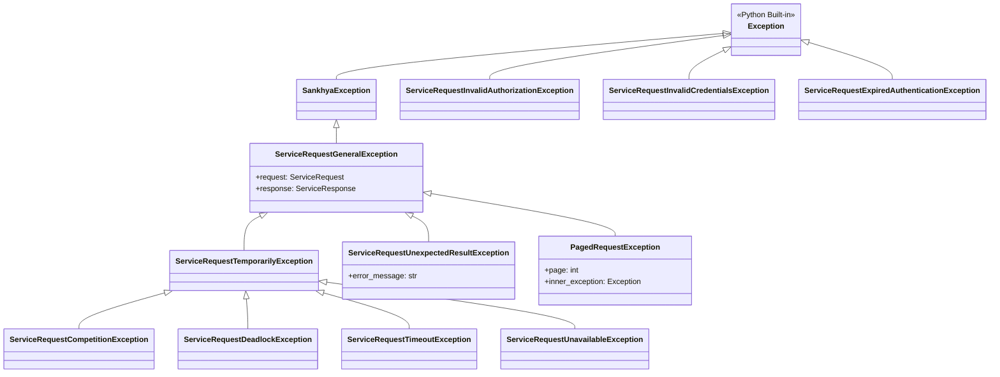
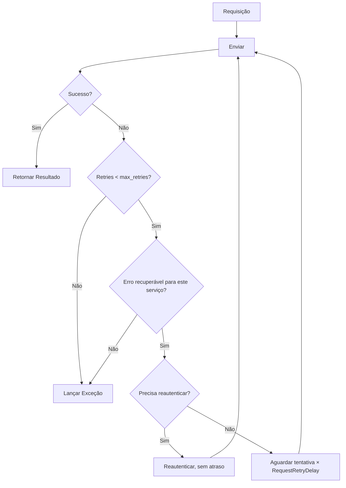

# Tratamento de Erros

Este documento explica a hierarquia de exceções do SDK (stack XML legada), a política de retry automático do `SankhyaWrapper` e boas práticas de tratamento de erros.

## Hierarquia de Exceções

O SDK define uma hierarquia de exceções para os diferentes tipos de erro:



`PagedRequestException` aparece com os atributos da subclasse lançada pelo
`PagedRequestWrapper` (`sankhya_sdk.request_wrappers.PagedRequestException`).
A referência completa está em [Exceções](../api-reference/exceptions.md).

## Exceções Principais

### SankhyaException

Classe base das exceções do SDK. Não define atributos próprios: a mensagem é
`str(e)` e a causa, quando houver, fica em `e.__cause__`:

```python
from sankhya_sdk.exceptions import SankhyaException
from sankhya_sdk.models.transport import Partner
from sankhya_sdk.request_wrappers import SimpleCRUDRequestWrapper

try:
    partner = SimpleCRUDRequestWrapper.find(Partner(code=1))
except SankhyaException as e:
    print(f"Erro Sankhya: {e}")
    if e.__cause__ is not None:
        print(f"Causa: {e.__cause__}")
```

### ServiceRequestGeneralException

Base dos erros de requisição de serviço, com a requisição e a resposta:

```python
from sankhya_sdk.exceptions import ServiceRequestGeneralException
from sankhya_sdk.models.transport import Partner
from sankhya_sdk.request_wrappers import SimpleCRUDRequestWrapper

try:
    partner = SimpleCRUDRequestWrapper.find(Partner(code=1))
except ServiceRequestGeneralException as e:
    print(f"Erro: {e}")
    if e.request is not None:
        print(f"Serviço: {e.request.service}")
    if e.response is not None:
        print(f"Mensagem do servidor: {e.response.status_message_text}")
```

### Exceções de autenticação

`ServiceRequestInvalidCredentialsException` (login recusado),
`ServiceRequestExpiredAuthenticationException` (usuário expirado) e
`ServiceRequestInvalidAuthorizationException` (sessão não autorizada)
derivam diretamente de `Exception`, e não de `SankhyaException`:

```python
from sankhya_sdk import SankhyaContext
from sankhya_sdk.exceptions import ServiceRequestInvalidCredentialsException

try:
    ctx = SankhyaContext.from_settings()
except ServiceRequestInvalidCredentialsException:
    print("Credenciais inválidas")
    # Não adianta retry - credenciais erradas
else:
    ctx.dispose()
```

### ServiceRequestCompetitionException

O Sankhya identificou a sessão como duplicada (mensagens `situação de
concorrência`, `log de acessos` ou violação da `PK_TSIRLG`). Não se trata de
lock de registro. Em serviços não transacionais o SDK reautentica e repete
sozinho; em serviços transacionais (como o `saveRecord` usado por
`SimpleCRUDRequestWrapper.update`) a exceção chega ao seu código:

```python
import logging

from sankhya_sdk.exceptions import ServiceRequestCompetitionException
from sankhya_sdk.models.transport import Partner
from sankhya_sdk.request_wrappers import SimpleCRUDRequestWrapper

partner = Partner(code=1, name="Novo Nome")
try:
    SimpleCRUDRequestWrapper.update(partner)
except ServiceRequestCompetitionException as e:
    logging.warning(f"Sessão duplicada: {e}")
    SimpleCRUDRequestWrapper.update(partner)  # Tentar novamente
```

### ServiceRequestDeadlockException

Deadlock no banco de dados. A mensagem é o texto do servidor; os atributos
são `request` e `response`. Consultas são repetidas automaticamente com
atraso; gravações (serviços transacionais) propagam a exceção na primeira
ocorrência:

```python
import logging

from sankhya_sdk.exceptions import ServiceRequestDeadlockException
from sankhya_sdk.models.transport import Partner
from sankhya_sdk.request_wrappers import SimpleCRUDRequestWrapper

try:
    SimpleCRUDRequestWrapper.update(Partner(code=1, name="Novo Nome"))
except ServiceRequestDeadlockException as e:
    logging.error(f"Deadlock na gravação: {e}")
    raise
```

## Retry Automático

O `SankhyaWrapper` repete automaticamente as requisições que falham por
erros temporários, com **atraso linear** entre as tentativas (mesma
política do `SankhyaWrapper` do SDK .NET):



### Configurando Retry

O único ajuste é o número máximo de retries (`max_retries`, padrão 3: uma
tentativa inicial e até 3 repetições). Ele é um parâmetro do
`SankhyaWrapper`:

```python
from sankhya_sdk import SankhyaContext, SankhyaWrapper

wrapper = SankhyaWrapper(host="http://sankhya.example.com", port=8180, max_retries=5)
wrapper.authenticate("usuario", "senha")
ctx = SankhyaContext(wrapper)
try:
    ...  # usar o contexto
finally:
    ctx.dispose()
```

Com `SankhyaContext.from_settings()` / `SankhyaWrapper.from_settings()`, o
valor vem de `SankhyaSettings.max_retries`, isto é, da variável de ambiente
`SANKHYA_MAX_RETRIES`. Os atrasos não são configuráveis.

### Atrasos entre tentativas

O atraso é `tentativa × RequestRetryDelay.X` segundos, em que `tentativa` é
o número da tentativa que falhou (1, 2, 3) e os valores de
`RequestRetryDelay` são `FREE = 10`, `STABLE = 15`, `UNSTABLE = 30` e
`BREAKDOWN = 90`:

| Erro | Ação | Atrasos (padrão de 3 retries) |
|------|------|-------------------------------|
| `ServiceRequestDeadlockException` | Retry | 15 s, 30 s, 45 s (`STABLE`) |
| `ServiceRequestCanceledQueryException` (consulta cancelada) | Retry | 15 s, 30 s, 45 s (`STABLE`) |
| `ServiceRequestPropertyValueException` com propriedade ausente do XML enviado | Retry | 15 s, 30 s, 45 s (`STABLE`) |
| `ServiceRequestTimeoutException` | Retry | 10 s, 20 s, 30 s (`FREE`) |
| `ServiceRequestUnavailableException` | Retry | 30 s, 60 s, 90 s (`UNSTABLE`) |
| Erro de rede ou HTTP 4xx/5xx (`requests.RequestException`) | Retry | 30 s, 60 s, 90 s (`UNSTABLE`) |
| `ServiceRequestCompetitionException` (sessão duplicada) | Reautenticar + retry | sem atraso |
| `ServiceRequestInvalidAuthorizationException` | Reautenticar + retry (se a sessão ainda não foi invalidada) | sem atraso |

A política vale para `service_invoker`/`service_invoker_async` (usados por
`SankhyaContext` e pelos request wrappers). O login (`authenticate`) não é
repetido: uma falha de autenticação é propagada na primeira tentativa.

O handler também cobre `ServiceRequestInaccessibleException` (reautentica
sem atraso, ou `BREAKDOWN` = 90 s, 180 s, 270 s nos serviços de
autenticação), como no SDK .NET, mas o transporte HTTP do SDK Python não
lança essa exceção: falhas de conexão chegam como `requests.RequestException`.

### Serviços transacionais

Em serviços **transacionais** (ex.: `CRUDServiceProvider.saveRecord`, usado
por `SimpleCRUDRequestWrapper.update`, e `CACSP.incluirNota`),
`ServiceRequestCompetitionException`, `ServiceRequestDeadlockException` e
`ServiceRequestTimeoutException` **não** são repetidas: a exceção é
propagada na primeira ocorrência, para não duplicar uma gravação. O tipo de
cada serviço está em `ServiceName.<SERVICO>.service_type`.

### Erros não recuperáveis

Os demais erros são propagados sem retry, por exemplo:

| Tipo de Erro | Exceção |
|--------------|---------|
| Credenciais inválidas | `ServiceRequestInvalidCredentialsException` |
| Usuário expirado | `ServiceRequestExpiredAuthenticationException` |
| Erro de validação de campo | `ServiceRequestPropertyNameException`, `ServiceRequestPropertyWidthException`, ... |
| Regra de negócio / chave estrangeira | `ServiceRequestBusinessRuleRestrictionException`, `ServiceRequestForeignKeyException` |
| Mensagem de erro não reconhecida | `ServiceRequestUnexpectedResultException` |

## Tratamento Manual de Erros

### Padrão Básico

```python
import logging
import sys

from sankhya_sdk import SankhyaContext
from sankhya_sdk.exceptions import (
    SankhyaException,
    ServiceRequestGeneralException,
    ServiceRequestInvalidCredentialsException,
)
from sankhya_sdk.models.transport import Partner
from sankhya_sdk.request_wrappers import SimpleCRUDRequestWrapper

try:
    ctx = SankhyaContext.from_settings()
except ServiceRequestInvalidCredentialsException:
    # Credenciais incorretas - não adianta retry
    logging.error("Credenciais inválidas")
    sys.exit(1)

try:
    SimpleCRUDRequestWrapper.initialize(ctx)
    partner = SimpleCRUDRequestWrapper.try_find(Partner(code=1))

except ServiceRequestGeneralException as e:
    # Erro retornado pelo serviço
    logging.error(f"Erro API: {e}")

except SankhyaException as e:
    # Outros erros do SDK
    logging.error(f"Erro SDK: {e}")

except Exception as e:
    # Erros inesperados
    logging.exception(f"Erro inesperado: {e}")

finally:
    SimpleCRUDRequestWrapper.dispose()
    ctx.dispose()
```

### Padrão com Retry Manual

Como gravações não são repetidas pelo SDK em caso de sessão duplicada, um
retry manual pode fazer sentido para operações idempotentes:

```python
import logging
import time

from sankhya_sdk.exceptions import ServiceRequestCompetitionException
from sankhya_sdk.models.transport import Partner
from sankhya_sdk.request_wrappers import SimpleCRUDRequestWrapper


def update_with_retry(entity: Partner, max_retries: int = 3) -> Partner:
    """Atualiza com retry manual para sessão duplicada."""
    for attempt in range(max_retries):
        try:
            return SimpleCRUDRequestWrapper.update(entity)
        except ServiceRequestCompetitionException:
            if attempt == max_retries - 1:
                raise
            delay = 2 ** attempt
            logging.warning(f"Retry em {delay}s (tentativa {attempt + 1})")
            time.sleep(delay)
    raise RuntimeError("max_retries deve ser maior que zero")
```

### Padrão com Circuit Breaker

```python
from datetime import datetime, timedelta
from typing import Any, Callable, Optional

from sankhya_sdk.exceptions import ServiceRequestGeneralException
from sankhya_sdk.models.transport import Partner
from sankhya_sdk.request_wrappers import SimpleCRUDRequestWrapper


class CircuitOpenError(Exception):
    """Circuito aberto: chamadas suspensas até o tempo de recuperação."""


class CircuitBreaker:
    def __init__(self, failure_threshold: int = 5, recovery_time: int = 60) -> None:
        self.failure_count = 0
        self.failure_threshold = failure_threshold
        self.recovery_time = timedelta(seconds=recovery_time)
        self.last_failure_time: Optional[datetime] = None
        self.state = "closed"  # closed, open, half-open

    def call(self, func: Callable[..., Any], *args: Any, **kwargs: Any) -> Any:
        if self.state == "open":
            assert self.last_failure_time is not None
            if datetime.now() - self.last_failure_time > self.recovery_time:
                self.state = "half-open"
            else:
                raise CircuitOpenError("Circuit breaker open")

        try:
            result = func(*args, **kwargs)
            self.reset()
            return result
        except ServiceRequestGeneralException:
            self.record_failure()
            raise

    def record_failure(self) -> None:
        self.failure_count += 1
        self.last_failure_time = datetime.now()
        if self.failure_count >= self.failure_threshold:
            self.state = "open"

    def reset(self) -> None:
        self.failure_count = 0
        self.state = "closed"


# Uso
breaker = CircuitBreaker()
cache: dict = {}

try:
    result = breaker.call(SimpleCRUDRequestWrapper.try_find, Partner(code=1))
except CircuitOpenError:
    # Sistema indisponível, usar fallback
    result = cache.get("partner:1")
```

## Logging de Erros

### Configuração Recomendada

```python
import logging

# Configuração de logging
logging.basicConfig(
    level=logging.INFO,
    format='%(asctime)s - %(name)s - %(levelname)s - %(message)s',
    handlers=[
        logging.FileHandler('sankhya_sdk.log'),
        logging.StreamHandler()
    ]
)

# Logger específico para erros
error_logger = logging.getLogger('sankhya_sdk.errors')
error_logger.setLevel(logging.ERROR)
```

Os módulos do SDK usam `logging.getLogger(__name__)` (por exemplo,
`sankhya_sdk.core.wrapper` registra os retries e os atrasos aplicados).

### Capturar Contexto de Erro

```python
import json
import logging
from datetime import datetime

from sankhya_sdk.exceptions import SankhyaException, ServiceRequestGeneralException
from sankhya_sdk.models.transport import Partner
from sankhya_sdk.request_wrappers import SimpleCRUDRequestWrapper

error_logger = logging.getLogger('sankhya_sdk.errors')


def log_error_with_context(error: Exception, context: dict) -> None:
    """Registra erro com contexto adicional."""
    error_data = {
        "timestamp": datetime.now().isoformat(),
        "error_type": type(error).__name__,
        "message": str(error),
        "context": context,
    }

    if isinstance(error, ServiceRequestGeneralException):
        if error.request is not None:
            error_data["service"] = str(error.request.service)
        if error.response is not None:
            error_data["status_message"] = error.response.status_message_text

    error_logger.error(json.dumps(error_data, indent=2, ensure_ascii=False))


# Uso
partner = Partner(code=1, name="Novo Nome")
try:
    SimpleCRUDRequestWrapper.update(partner)
except SankhyaException as e:
    log_error_with_context(e, {
        "entity_type": "Partner",
        "entity_id": partner.code,
        "operation": "update"
    })
    raise
```

## Mensagens de Status

Quando a resposta tem `status="0"` (`ServiceResponseStatus.ERROR`), o
`SankhyaWrapper` chama `StatusMessageHelper.process_status_message`, que
converte a `statusMessage` na exceção correspondente (veja a tabela em
[Exceções](../api-reference/exceptions.md#como-o-sdk-escolhe-a-excecao)).

O servidor envia a `statusMessage` em Base64. Como o SDK .NET, o SDK a
decodifica ao ler a resposta (UTF-8, ou ISO-8859-1 como alternativa) antes
de procurar os trechos conhecidos; um texto que não seja Base64 válido é
mantido como veio. Por isso mensagens reais como deadlock, timeout ou sessão
expirada viram as exceções específicas, e não
`ServiceRequestUnexpectedResultException`.

A mensagem original (já decodificada) continua acessível pela resposta
guardada na exceção:

```python
from sankhya_sdk.exceptions import ServiceRequestGeneralException
from sankhya_sdk.models.transport import Partner
from sankhya_sdk.request_wrappers import SimpleCRUDRequestWrapper

try:
    SimpleCRUDRequestWrapper.update(Partner(code=1, name="Novo Nome"))
except ServiceRequestGeneralException as e:
    print(f"Tipo: {type(e).__name__}")
    if e.response is not None:
        print(f"Status: {e.response.status}")
        print(f"Mensagem: {e.response.status_message_text}")
```

## Boas Práticas

### 1. Seja Específico no Catch

```python
from sankhya_sdk.exceptions import (
    SankhyaException,
    ServiceRequestCompetitionException,
    ServiceRequestGeneralException,
    ServiceRequestInvalidAuthorizationException,
)
from sankhya_sdk.models.transport import Partner
from sankhya_sdk.request_wrappers import SimpleCRUDRequestWrapper

partner = Partner(code=1, name="Novo Nome")

# ✅ Bom - específico
try:
    SimpleCRUDRequestWrapper.update(partner)
except ServiceRequestInvalidAuthorizationException:
    ...  # Tratar autenticação
except ServiceRequestCompetitionException:
    ...  # Tratar sessão duplicada
except ServiceRequestGeneralException:
    ...  # Outros erros de requisição
except SankhyaException:
    ...  # Outros erros do SDK

# ❌ Evitar - genérico demais
try:
    SimpleCRUDRequestWrapper.update(partner)
except Exception:
    ...  # Não sabe o que aconteceu
```

### 2. Não Engula Exceções

```python
import logging

from sankhya_sdk.exceptions import SankhyaException
from sankhya_sdk.models.transport import Partner
from sankhya_sdk.request_wrappers import SimpleCRUDRequestWrapper

partner = Partner(code=1, name="Novo Nome")

# ✅ Bom - log e propaga
try:
    SimpleCRUDRequestWrapper.update(partner)
except SankhyaException as e:
    logging.error(f"Erro: {e}")
    raise

# ❌ Evitar - engole exceção
try:
    SimpleCRUDRequestWrapper.update(partner)
except SankhyaException:
    pass  # Silencioso, problema será difícil de debugar
```

### 3. Use Contexto Adequado

```python
from sankhya_sdk.exceptions import SankhyaException
from sankhya_sdk.models.transport import Partner
from sankhya_sdk.request_wrappers import SimpleCRUDRequestWrapper


class PartnerUpdateError(Exception):
    """Erro da aplicação ao atualizar parceiro."""


partner = Partner(code=1, name="Novo Nome")

# ✅ Bom - adiciona contexto e preserva a causa
try:
    SimpleCRUDRequestWrapper.update(partner)
except SankhyaException as e:
    raise PartnerUpdateError(f"Falha ao atualizar parceiro {partner.code}") from e
```

### 4. Implemente Fallbacks

```python
from typing import Dict, Optional

from sankhya_sdk.exceptions import ServiceRequestGeneralException
from sankhya_sdk.models.transport import Partner
from sankhya_sdk.request_wrappers import SimpleCRUDRequestWrapper

cache: Dict[str, Partner] = {}


def get_partner(code: int) -> Optional[Partner]:
    """Busca parceiro com fallback para cache."""
    try:
        return SimpleCRUDRequestWrapper.try_find(Partner(code=code))
    except ServiceRequestGeneralException:
        # Fallback para cache local
        return cache.get(f"partner:{code}")
```

### 5. Monitore Erros

```python
from collections import Counter
from functools import wraps
from typing import Any, Callable

from sankhya_sdk.exceptions import SankhyaException
from sankhya_sdk.models.transport import Partner
from sankhya_sdk.request_wrappers import SimpleCRUDRequestWrapper

error_counter: Counter = Counter()


def monitored_operation(func: Callable[..., Any]) -> Callable[..., Any]:
    """Decorator que monitora erros."""
    @wraps(func)
    def wrapper(*args: Any, **kwargs: Any) -> Any:
        try:
            return func(*args, **kwargs)
        except SankhyaException as e:
            error_counter[type(e).__name__] += 1
            raise
    return wrapper


@monitored_operation
def update_partner(partner: Partner) -> Partner:
    return SimpleCRUDRequestWrapper.update(partner)


# Relatório periódico
def error_report() -> None:
    for error_type, count in error_counter.most_common():
        print(f"{error_type}: {count} ocorrências")
```

## Próximos Passos

- [Exemplos: Tratamento de Erros](../examples/error-handling.md) - Exemplos práticos
- [Referência: Exceções](../api-reference/exceptions.md) - API completa
- [Request Helpers](../api-reference/helpers.md) - Constantes de retry (`RequestRetryDelay`)
