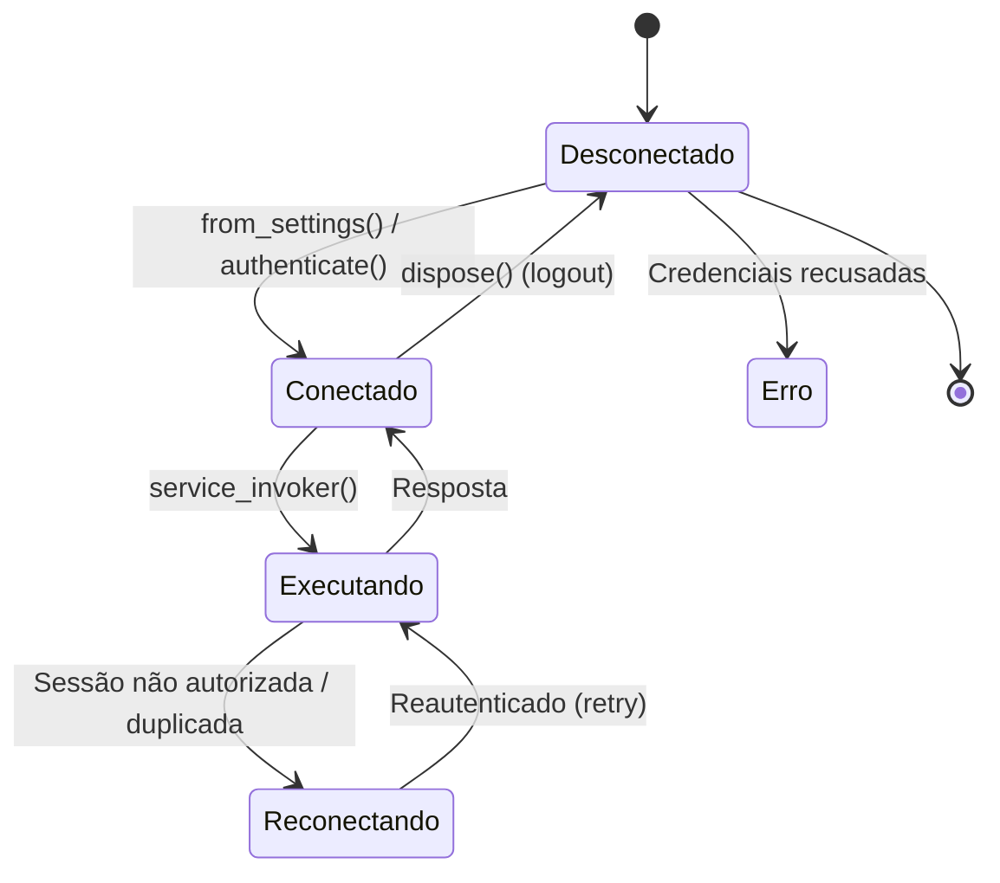
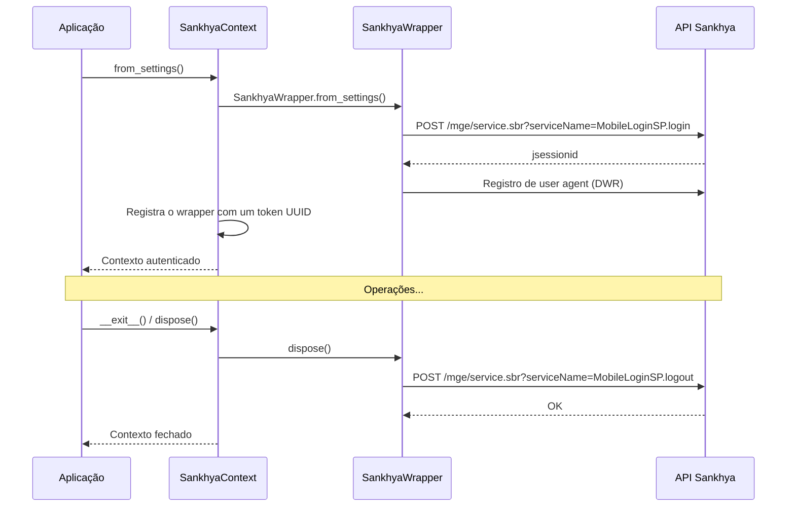
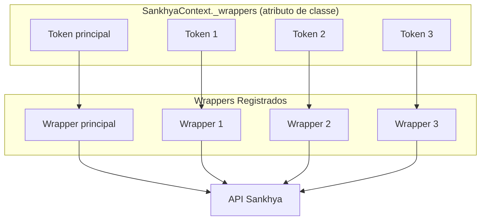
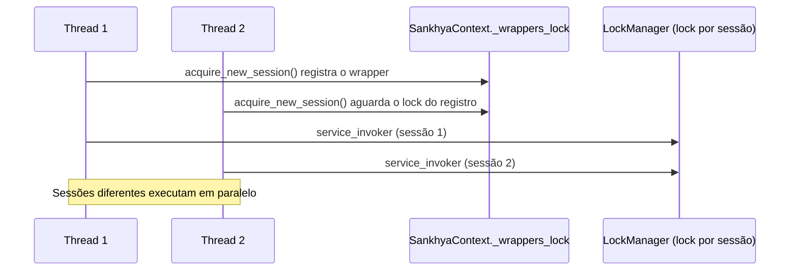
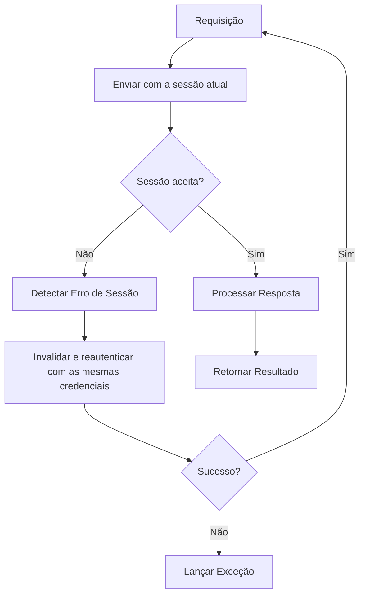

# Gerenciamento de Sessões

Este documento explica como o Sankhya SDK gerencia as sessões de autenticação da API XML legada (`SankhyaContext` e `SankhyaWrapper`), incluindo sessões únicas, múltiplas sessões e considerações de concorrência.

## Visão Geral

O SDK oferece dois modos de gerenciamento de sessões:

| Modo | Descrição | Uso Típico |
|------|-----------|------------|
| **Sessão Única** | A sessão principal do contexto | Aplicações simples, scripts |
| **Múltiplas Sessões** | Sessões adicionais identificadas por token (`uuid.UUID`) | Aplicações multi-thread, APIs |

Cada sessão é um `SankhyaWrapper` autenticado (um login). O `SankhyaContext`
registra os wrappers num dicionário **de classe**, compartilhado por todos os
contextos do processo (como o dicionário estático `Wrappers` do SDK .NET).

## Ciclo de Vida de Sessões



## Sessão Única

### Uso Básico

O modo mais simples, usando context manager. A variável do `with` recebe o
`SankhyaWrapper` da sessão principal:

```python
from sankhya_sdk import SankhyaContext
from sankhya_sdk.enums import ServiceName
from sankhya_sdk.helpers import ServiceRequestExtensions
from sankhya_sdk.models.service import ServiceRequest
from sankhya_sdk.models.transport import Partner

request = ServiceRequest(service=ServiceName.CRUD_SERVICE_FIND)
ServiceRequestExtensions.resolve_with_entity(request, Partner(code=1))

# Sessão abre automaticamente
with SankhyaContext.from_settings() as wrapper:
    # Operações aqui
    response = wrapper.service_invoker(request)
    print(f"Registros: {len(response.entities)}")
# Sessão fecha automaticamente (logout)
```

### Fluxo de Autenticação



### Sem Context Manager

Para controle manual do ciclo de vida (e para passar o contexto a um request
wrapper):

```python
from sankhya_sdk import SankhyaContext
from sankhya_sdk.models.transport import Partner
from sankhya_sdk.request_wrappers import SimpleCRUDRequestWrapper

ctx = SankhyaContext.from_settings()
try:
    # Operações
    SimpleCRUDRequestWrapper.initialize(ctx)
    partner = SimpleCRUDRequestWrapper.try_find(Partner(code=1))
finally:
    SimpleCRUDRequestWrapper.dispose()
    ctx.dispose()  # Importante: sempre chamar dispose()
```

!!! warning "Importante: o `__del__` não faz logout"
    Sempre chame `dispose()` (ou use `with`). O `__del__` do `SankhyaContext`
    apenas marca o contexto como descartado, como o finalizer do SDK .NET
    (`~SankhyaContext() => Dispose(false)`): um contexto coletado pelo GC sem
    `dispose()` não faz logout, e seus wrappers continuam no registro de
    classe até que algum contexto chame `dispose()`. Versões anteriores do SDK
    chamavam `dispose()` no `__del__`, o que podia encerrar, a qualquer
    momento, sessões de outros contextos ainda em uso.

### Informações da Sessão

```python
from sankhya_sdk import SankhyaContext

ctx = SankhyaContext.from_settings()
try:
    print(f"Token principal: {ctx.token}")
    print(f"Usuário: {ctx.user_name} (código {ctx.user_code})")
    print(f"Ambiente: {ctx.environment.name}")
    print(f"Banco: {ctx.database_name}")
    print(f"JSESSIONID: {ctx.wrapper.session_id}")
finally:
    ctx.dispose()
```

## Múltiplas Sessões

Para aplicações que precisam de paralelismo ou isolamento de operações.

### Adquirindo Sessões

`acquire_new_session` cria um novo `SankhyaWrapper` com as credenciais da
sessão principal, autentica (um login) e devolve o token. As requisições com
token usam os métodos estáticos `SankhyaContext.service_invoker_with_token`
e `service_invoker_async_with_token`:

```python
from sankhya_sdk import SankhyaContext
from sankhya_sdk.enums import ServiceName, ServiceRequestType
from sankhya_sdk.helpers import ServiceRequestExtensions
from sankhya_sdk.models.service import ServiceRequest
from sankhya_sdk.models.transport import Partner, Product

request1 = ServiceRequest(service=ServiceName.CRUD_SERVICE_FIND)
ServiceRequestExtensions.resolve_with_entity(request1, Partner(code=1))
request2 = ServiceRequest(service=ServiceName.CRUD_SERVICE_FIND)
ServiceRequestExtensions.resolve_with_entity(request2, Product(code=10))

# Cria contexto principal
ctx = SankhyaContext.from_settings()
try:
    # Adquire sessões adicionais
    token1 = ctx.acquire_new_session()  # Retorna uuid.UUID
    token2 = ctx.acquire_new_session(ServiceRequestType.DEFAULT)

    print(f"Sessão 1: {token1}")
    print(f"Sessão 2: {token2}")

    # Usa sessões
    result1 = SankhyaContext.service_invoker_with_token(request1, token1)
    result2 = SankhyaContext.service_invoker_with_token(request2, token2)

    # Finaliza sessões
    ctx.finalize_session(token1)
    ctx.finalize_session(token2)
finally:
    ctx.dispose()
```

`finalize_session` ignora o token da sessão principal (use `dispose()` para
encerrá-la). Sessões adquiridas com `ServiceRequestType.ON_DEMAND_CRUD` são
rastreadas pelo contexto e finalizadas primeiro no `dispose()`.

### Diagrama de Múltiplas Sessões



!!! warning "Registro compartilhado"
    Como o registro é de classe, `dispose()` de **qualquer** contexto encerra
    **todas** as sessões registradas no processo, inclusive as de outros
    contextos (mesmo comportamento do `Dispose` do SDK .NET). Em aplicações
    com vários contextos, chame `dispose()` só quando nenhum deles for mais
    usado, e use `finalize_session(token)` para liberar sessões individuais.

    Com sessões on-demand, o `dispose()` chama antes
    `OnDemandRequestFactory.finalize_all()` (como o .NET): cada worker envia
    o restante da fila e libera a própria sessão antes do logout das demais.
    Os `AsyncOnDemandRequestWrapper` só são aguardados na saída de
    `async with ctx:`; fora dele, aguarde
    `AsyncOnDemandRequestFactory.finalize_all()` antes do `dispose()`.

### Sessões dos Request Wrappers

| Wrapper | Sessão usada |
|---------|--------------|
| `SimpleCRUDRequestWrapper.initialize(ctx)` | Adquire uma sessão dedicada (`ServiceRequestType.SIMPLE_CRUD`, um login extra), finalizada por `SimpleCRUDRequestWrapper.dispose()` |
| `SimpleCRUDRequestWrapper.initialize()` (ou `with SimpleCRUDRequestWrapper():`) | Cria um contexto próprio e adquire dele a sessão dedicada; `dispose()` encerra as duas sessões, sem afetar outros contextos |
| `KnowServicesRequestWrapper.initialize(ctx)` | Usa a sessão principal do contexto (não faz login extra); `dispose()` não a encerra. Divergência do .NET, que sempre adquire uma sessão `KnowServices` própria |
| `KnowServicesRequestWrapper.initialize()` | Cria um contexto próprio e adquire dele uma sessão `KNOW_SERVICES`; `dispose()` encerra as duas sessões |
| `PagedRequestWrapper.get_paged_results(..., token)` | Usa a sessão do token informado (ex.: `ctx.token`) |
| `OnDemandRequestFactory.create_instance(..., context=ctx)` | Adquire uma sessão `ON_DEMAND_CRUD` própria, finalizada quando o worker do wrapper termina |

## Thread Safety

O registro de sessões é protegido por lock, e as requisições de uma mesma
sessão são serializadas por um lock por sessão (`LockManager`). Para
paralelismo real, use uma sessão por thread.

### Exemplo Multi-threaded

```python
from concurrent.futures import ThreadPoolExecutor
from typing import List

from sankhya_sdk import SankhyaContext
from sankhya_sdk.enums import ServiceName
from sankhya_sdk.helpers import ServiceRequestExtensions
from sankhya_sdk.models.service import ServiceRequest
from sankhya_sdk.models.transport import Partner

ctx = SankhyaContext.from_settings()


def build_request(partner: Partner) -> ServiceRequest:
    request = ServiceRequest(service=ServiceName.CRUD_SERVICE_SAVE)
    ServiceRequestExtensions.resolve_with_entity(request, partner)
    return request


def process_batch(batch_id: int, items: List[Partner]) -> None:
    """Processa um lote em uma thread separada."""
    token = ctx.acquire_new_session()
    try:
        # Cada thread tem sua própria sessão
        for item in items:
            SankhyaContext.service_invoker_with_token(build_request(item), token)
            print(f"Batch {batch_id}: Processado parceiro {item.code}")
    finally:
        ctx.finalize_session(token)


# Divide trabalho em lotes
all_items = [Partner(code=i, name=f"Parceiro {i}") for i in range(1, 501)]
batches = [all_items[i:i+100] for i in range(0, len(all_items), 100)]

try:
    # Processa em paralelo
    with ThreadPoolExecutor(max_workers=5) as executor:
        futures = [
            executor.submit(process_batch, i, batch)
            for i, batch in enumerate(batches)
        ]

        for future in futures:
            future.result()  # Aguarda conclusão
finally:
    ctx.dispose()
```

### Locks Internos



## Async/Await

O `SankhyaContext` suporta `async with`, e as chamadas assíncronas
(`service_invoker_async`, `get_file_async`, ...) executam a chamada síncrona
em uma thread (`asyncio.to_thread`). Não há dependências extras:

```python
import asyncio

from sankhya_sdk import SankhyaContext
from sankhya_sdk.enums import ServiceName
from sankhya_sdk.helpers import ServiceRequestExtensions
from sankhya_sdk.models.service import ServiceRequest
from sankhya_sdk.models.transport import Partner


def find_request(code: int) -> ServiceRequest:
    request = ServiceRequest(service=ServiceName.CRUD_SERVICE_FIND)
    ServiceRequestExtensions.resolve_with_entity(request, Partner(code=code))
    return request


async def main() -> None:
    async with SankhyaContext.from_settings() as wrapper:
        # Operações assíncronas
        response = await wrapper.service_invoker_async(find_request(1))

        # Várias requisições concorrentes (serializadas na mesma sessão)
        tasks = [wrapper.service_invoker_async(find_request(i)) for i in range(1, 10)]
        results = await asyncio.gather(*tasks)
        print(f"{len(results)} respostas")

asyncio.run(main())
```

### Múltiplas Sessões Assíncronas

```python
import asyncio
from typing import List

from sankhya_sdk import SankhyaContext
from sankhya_sdk.enums import ServiceName
from sankhya_sdk.helpers import ServiceRequestExtensions
from sankhya_sdk.models.service import ServiceRequest, ServiceResponse
from sankhya_sdk.models.transport import Partner


def build_request(partner: Partner) -> ServiceRequest:
    request = ServiceRequest(service=ServiceName.CRUD_SERVICE_FIND)
    ServiceRequestExtensions.resolve_with_entity(request, partner)
    return request


async def process_with_session(ctx: SankhyaContext, item: Partner) -> ServiceResponse:
    """Processa item com sessão própria."""
    # acquire_new_session e finalize_session são síncronos (login/logout)
    token = await asyncio.to_thread(ctx.acquire_new_session)
    try:
        return await SankhyaContext.service_invoker_async_with_token(
            build_request(item), token
        )
    finally:
        await asyncio.to_thread(ctx.finalize_session, token)


async def main() -> None:
    ctx = SankhyaContext.from_settings()
    try:
        items: List[Partner] = [Partner(code=i) for i in range(1, 6)]

        # Processa todos em paralelo
        results = await asyncio.gather(*[
            process_with_session(ctx, item)
            for item in items
        ])
        print(f"{len(results)} respostas")
    finally:
        ctx.dispose()

asyncio.run(main())
```

## Renovação de Sessão

O SDK reautentica automaticamente quando o servidor responde que a sessão não
está autorizada (`ServiceRequestInvalidAuthorizationException`) ou que ela foi
identificada como duplicada (`ServiceRequestCompetitionException`, apenas em
serviços não transacionais):



### Timeout e Retries

Não há configuração de tempo de sessão no SDK: a expiração é controlada pelo
servidor e a renovação é automática. Os ajustes disponíveis são o timeout
HTTP e o número de retries do `SankhyaWrapper` (`SANKHYA_TIMEOUT` e
`SANKHYA_MAX_RETRIES` em `SankhyaSettings`):

```python
from sankhya_sdk import SankhyaContext, SankhyaWrapper

wrapper = SankhyaWrapper(
    host="http://sankhya.example.com",
    port=8180,
    timeout=60,      # Timeout HTTP (segundos)
    max_retries=5,   # Retries automáticos
)
wrapper.authenticate("usuario", "senha")

ctx = SankhyaContext(wrapper)
ctx.dispose()
```

## Boas Práticas

### 1. Use Context Managers (ou try/finally)

```python
from sankhya_sdk import SankhyaContext

# ✅ Correto
with SankhyaContext.from_settings() as wrapper:
    ...

# ✅ Correto quando o contexto é passado a um request wrapper
ctx = SankhyaContext.from_settings()
try:
    ...
finally:
    ctx.dispose()

# ❌ Evitar (o __del__ não faz logout)
ctx = SankhyaContext.from_settings()
...
# Se exceção ocorrer aqui, a sessão não fecha
```

### 2. Limite Sessões Simultâneas

```python
from concurrent.futures import ThreadPoolExecutor

# ✅ Limitar workers (uma sessão por worker)
with ThreadPoolExecutor(max_workers=5) as executor:
    ...

# ❌ Evitar muitas sessões
with ThreadPoolExecutor(max_workers=100) as executor:
    # Pode exceder limite do servidor
    ...
```

### 3. Feche Sessões Não Utilizadas

```python
from sankhya_sdk import SankhyaContext

ctx = SankhyaContext.from_settings()

# ✅ Finalizar explicitamente
token = ctx.acquire_new_session()
try:
    ...  # operações
finally:
    ctx.finalize_session(token)

# ❌ Não deixar sessões abertas
token = ctx.acquire_new_session()
...  # operações (se exceção, a sessão fica aberta até o dispose())

ctx.dispose()
```

### 4. Trate Erros de Sessão

```python
from sankhya_sdk import SankhyaContext
from sankhya_sdk.exceptions import (
    ServiceRequestExpiredAuthenticationException,
    ServiceRequestGeneralException,
    ServiceRequestInvalidAuthorizationException,
    ServiceRequestInvalidCredentialsException,
)
from sankhya_sdk.models.transport import Partner
from sankhya_sdk.request_wrappers import SimpleCRUDRequestWrapper

try:
    ctx = SankhyaContext.from_settings()
except (ServiceRequestInvalidCredentialsException,
        ServiceRequestExpiredAuthenticationException):
    # Credenciais inválidas ou usuário expirado - não adianta retry
    raise

try:
    SimpleCRUDRequestWrapper.initialize(ctx)
    partner = SimpleCRUDRequestWrapper.try_find(Partner(code=1))
except ServiceRequestInvalidAuthorizationException:
    # O SDK já tentou reautenticar; a sessão continua sendo recusada
    raise
except ServiceRequestGeneralException as e:
    print(f"Erro de serviço: {e}")
finally:
    SimpleCRUDRequestWrapper.dispose()
    ctx.dispose()
```

## Monitoramento

### Logging de Sessões

```python
import logging

# Configura logging detalhado
logging.basicConfig(level=logging.DEBUG)

# Logs incluirão:
# - Login (sankhya_sdk.core.wrapper)
# - Aquisição/finalização de sessões (sankhya_sdk.core.context)
# - Retries e reautenticações (sankhya_sdk.core.wrapper)
logging.getLogger('sankhya_sdk.core').setLevel(logging.DEBUG)
```

### Sessões no Servidor

O `KnowServicesRequestWrapper` lista e encerra sessões do servidor
(`SessionManagerSP`):

```python
from sankhya_sdk import SankhyaContext
from sankhya_sdk.request_wrappers import KnowServicesRequestWrapper

ctx = SankhyaContext.from_settings()
try:
    KnowServicesRequestWrapper.initialize(ctx)  # usa a sessão principal
    for session in KnowServicesRequestWrapper.get_sessions():
        print(f"{session.session_id}: {session.user_name} @ {session.host}")
    print(f"Requisições nesta sessão: {ctx.wrapper.request_count}")
finally:
    KnowServicesRequestWrapper.dispose()
    ctx.dispose()
```

## Próximos Passos

- [Sistema de Entidades](entity-system.md) - Criação de entidades
- [Tratamento de Erros](error-handling.md) - Estratégias de erro
- [Exemplos](../examples/session-management.md) - Exemplos práticos
