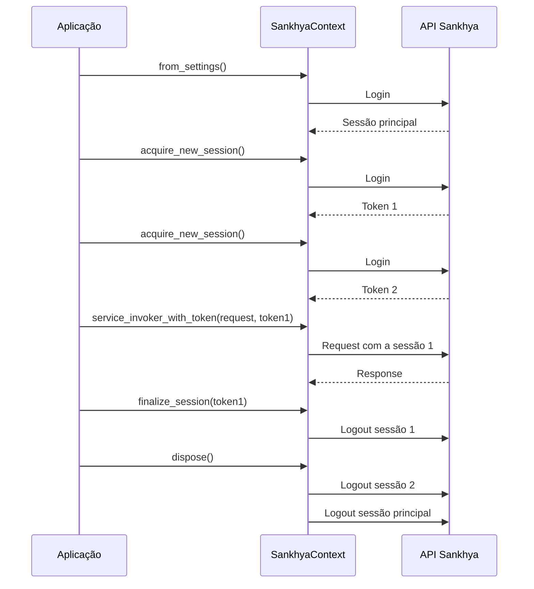

# Autenticação

Este guia detalha os métodos de autenticação disponíveis no SDK e boas práticas de segurança.

## Visão Geral

O Sankhya SDK suporta múltiplos métodos de autenticação:

| Método | Segurança | Uso Recomendado |
|--------|-----------|-----------------|
| OAuth2 (Token) | ⭐⭐⭐⭐⭐ | **Recomendado** (Novas Integrações) |
| Variáveis de ambiente (usuário/senha, legado) | ⭐⭐⭐ | Desenvolvimento, CI/CD e produção (API XML) |
| Configuração direta (legado) | ⭐⭐ | Testes |

## Método Recomendado: OAuth2 (Bearer Token)

O novo fluxo de autenticação utiliza o padrão **OAuth2** com credenciais (`client_id`, `client_secret`) e opcionalmente um token proprietário (`X-Token`). É mais seguro e performático para novas integrações.

### 1. Obter Credenciais

Acesse o [Portal do Desenvolvedor Sankhya](https://areadev.sankhya.com.br/):
1. Crie uma **Solução**.
2. Crie um **Componente de Integração**.
3. Copie o **Client ID** e **Client Secret**.

### 2. Configuração (.env)

```ini
SANKHYA_CLIENT_ID=seu_client_id
SANKHYA_CLIENT_SECRET=seu_client_secret
SANKHYA_AUTH_BASE_URL=https://api.sankhya.com.br
SANKHYA_TOKEN=seu_x_token  # Opcional (se exigido pelo ambiente)
```

### 3. Uso com SankhyaSession

```python
import os
from dotenv import load_dotenv
from sankhya_sdk.auth.oauth_client import OAuthClient
from sankhya_sdk.http.session import SankhyaSession

# Carregar variáveis
load_dotenv()

# Inicializar Cliente OAuth
oauth = OAuthClient(
    base_url=os.getenv("SANKHYA_AUTH_BASE_URL"),
    token=os.getenv("SANKHYA_TOKEN")
)

# Autenticar
oauth.authenticate(
    client_id=os.getenv("SANKHYA_CLIENT_ID"),
    client_secret=os.getenv("SANKHYA_CLIENT_SECRET")
)

# Criar Sessão Autenticada
session = SankhyaSession(oauth_client=oauth)

# Realizar Requisições
# O header 'Authorization: Bearer ...' é injetado automaticamente
response = session.get("/gateway/v1/mge/servico/exemplo")

print(response.json())
```

### Renovação de Token
O `SankhyaSession` detecta automaticamente erros `401 Unauthorized` e tenta renovar o token usando o `refresh_token` armazenado, repetindo a requisição original de forma transparente.

---

## Método 1: Variáveis de Ambiente (Legado)

A API XML legada autentica com usuário e senha (`MobileLoginSP.login`).

### Configuração

Crie um arquivo `.env` (ou defina as variáveis no ambiente):

```ini
SANKHYA_URL=http://seu-servidor.com.br
SANKHYA_PORT=8180
SANKHYA_USERNAME=seu_usuario
SANKHYA_PASSWORD=sua_senha
```

### Uso

```python
from sankhya_sdk import SankhyaContext

ctx = SankhyaContext.from_settings()
try:
    print(f"Autenticado como: {ctx.user_name} (código {ctx.user_code})")
finally:
    ctx.dispose()
```

`SankhyaContext.from_settings()` sem argumentos usa a instância global
`sankhya_sdk.config.settings`, criada na importação do módulo a partir das
variáveis de ambiente e do arquivo `.env` do diretório atual. Para usar
valores definidos depois da importação, passe um `SankhyaSettings` novo
(veja o Método 2).

### Variáveis Disponíveis

| Variável | Obrigatória | Descrição |
|----------|-------------|-----------|
| `SANKHYA_URL` | Não (padrão `http://localhost`) | URL do servidor, sem a porta |
| `SANKHYA_PORT` | Não (padrão `8180`) | Porta; também define o ambiente: 8180 produção, 8280 homologação, 8380 treinamento |
| `SANKHYA_USERNAME` | Sim | Nome de usuário |
| `SANKHYA_PASSWORD` | Sim | Senha do usuário |
| `SANKHYA_TIMEOUT` | Não | Timeout HTTP em segundos (padrão: 30) |
| `SANKHYA_MAX_RETRIES` | Não | Máximo de retries automáticos (padrão: 3) |

`SankhyaSettings` também lê `SANKHYA_KEY_PATH`, `SANKHYA_APPKEY`,
`SANKHYA_TOKEN` e `SANKHYA_LOG_LEVEL`, mas o login do `SankhyaWrapper` usa
apenas usuário e senha.

## Método 2: Configuração Direta

Para testes e desenvolvimento rápido. Os campos de `SankhyaSettings` são
informados pelos nomes das variáveis (aliases):

```python
from sankhya_sdk import SankhyaContext
from sankhya_sdk.config import SankhyaSettings

settings = SankhyaSettings(
    SANKHYA_URL="http://sankhya.example.com",
    SANKHYA_PORT=8180,
    SANKHYA_USERNAME="usuario_teste",
    SANKHYA_PASSWORD="senha_teste",
)

with SankhyaContext.from_settings(settings) as wrapper:
    print(f"Sessão: {wrapper.session_id}")
```

Também é possível informar host, porta e credenciais diretamente:

```python
from sankhya_sdk import SankhyaContext

ctx = SankhyaContext(
    host="http://sankhya.example.com",
    port=8180,
    username="usuario_teste",
    password="senha_teste",
)
ctx.dispose()
```

!!! danger "Aviso"
    Nunca use credenciais hardcoded em código de produção!

## Gerenciamento de Sessões

### Sessão Única (Padrão)

O context manager gerencia automaticamente login/logout. A variável do
`with` recebe o `SankhyaWrapper` da sessão principal:

```python
from sankhya_sdk import SankhyaContext
from sankhya_sdk.enums import ServiceName
from sankhya_sdk.helpers import ServiceRequestExtensions
from sankhya_sdk.models.service import ServiceRequest
from sankhya_sdk.models.transport import Partner

request = ServiceRequest(service=ServiceName.CRUD_SERVICE_FIND)
ServiceRequestExtensions.resolve_with_entity(request, Partner(code=1))

with SankhyaContext.from_settings() as wrapper:
    # Sessão aberta
    response = wrapper.service_invoker(request)
# Sessão fechada (logout automático)
```

### Múltiplas Sessões

Para aplicações que precisam de múltiplas sessões simultâneas:

```python
from sankhya_sdk import SankhyaContext
from sankhya_sdk.enums import ServiceName
from sankhya_sdk.helpers import ServiceRequestExtensions
from sankhya_sdk.models.service import ServiceRequest
from sankhya_sdk.models.transport import Partner

request = ServiceRequest(service=ServiceName.CRUD_SERVICE_FIND)
ServiceRequestExtensions.resolve_with_entity(request, Partner(code=1))

# Cria contexto principal
ctx = SankhyaContext.from_settings()
try:
    # Adquire sessões adicionais (um login cada)
    token1 = ctx.acquire_new_session()
    token2 = ctx.acquire_new_session()

    # Usa sessões específicas
    result1 = SankhyaContext.service_invoker_with_token(request, token1)
    result2 = SankhyaContext.service_invoker_with_token(request, token2)

    # Finaliza uma sessão adicional
    ctx.finalize_session(token1)
finally:
    # Logout das sessões restantes (token2 e principal)
    ctx.dispose()
```



### Thread Safety

O registro de sessões do `SankhyaContext` é protegido por lock, e as
requisições de uma mesma sessão são serializadas. Para paralelismo, use uma
sessão por thread:

```python
import threading

from sankhya_sdk import SankhyaContext
from sankhya_sdk.enums import ServiceName
from sankhya_sdk.helpers import ServiceRequestExtensions
from sankhya_sdk.models.service import ServiceRequest
from sankhya_sdk.models.transport import Partner

ctx = SankhyaContext.from_settings()


def worker(thread_id: int) -> None:
    """Cada thread usa uma sessão separada."""
    token = ctx.acquire_new_session()
    try:
        request = ServiceRequest(service=ServiceName.CRUD_SERVICE_FIND)
        ServiceRequestExtensions.resolve_with_entity(request, Partner(code=thread_id + 1))
        response = SankhyaContext.service_invoker_with_token(request, token)
        print(f"Thread {thread_id}: {len(response.entities)} registro(s)")
    finally:
        ctx.finalize_session(token)


# Cria threads
threads = [
    threading.Thread(target=worker, args=(i,))
    for i in range(5)
]

# Inicia threads
for t in threads:
    t.start()

# Aguarda conclusão
for t in threads:
    t.join()

ctx.dispose()
```

## Renovação Automática de Sessão

Se o servidor responder que a sessão não está autorizada (sessão expirada
ou derrubada), o `SankhyaWrapper` autentica de novo com as mesmas
credenciais e repete a requisição:

```python
from sankhya_sdk import SankhyaContext
from sankhya_sdk.models.transport import Partner
from sankhya_sdk.request_wrappers import SimpleCRUDRequestWrapper

ctx = SankhyaContext.from_settings()
try:
    SimpleCRUDRequestWrapper.initialize(ctx)

    # Se a sessão expirar durante uma operação, o SDK automaticamente:
    # 1. Detecta o erro de autorização
    # 2. Faz login novamente
    # 3. Repete a operação
    for code in range(1, 1001):  # Operação longa
        SimpleCRUDRequestWrapper.try_find(Partner(code=code))
finally:
    SimpleCRUDRequestWrapper.dispose()
    ctx.dispose()
```

## Boas Práticas de Segurança

### 1. Nunca Versione Credenciais

```gitignore
# .gitignore
.env
.env.*
*.key
credentials/
```

### 2. Use Variáveis de Ambiente em CI/CD

```yaml
# GitHub Actions
env:
  SANKHYA_URL: ${{ secrets.SANKHYA_URL }}
  SANKHYA_USERNAME: ${{ secrets.SANKHYA_USER }}
  SANKHYA_PASSWORD: ${{ secrets.SANKHYA_PASS }}
```

### 3. Rotacione Credenciais Regularmente

Troque a senha do usuário de integração periodicamente e atualize o segredo
usado em `SANKHYA_PASSWORD`. Antes de publicar a nova senha, valide-a com um
login:

```python
import os

from sankhya_sdk import SankhyaContext
from sankhya_sdk.config import SankhyaSettings

new_settings = SankhyaSettings(
    SANKHYA_URL=os.environ.get("SANKHYA_URL", "http://localhost"),
    SANKHYA_USERNAME=os.environ.get("SANKHYA_USERNAME", "usuario"),
    SANKHYA_PASSWORD=os.environ.get("SANKHYA_NEW_PASSWORD", ""),
)

# Lança ServiceRequestInvalidCredentialsException se a senha for recusada
SankhyaContext.from_settings(new_settings).dispose()
```

### 4. Use Usuários com Permissões Mínimas

Crie usuários específicos para cada integração com apenas as permissões necessárias:

| Integração | Permissões |
|------------|------------|
| Sincronização de Produtos | Leitura de produtos |
| Faturamento | CRUD de notas fiscais |
| Relatórios | Leitura geral |

### 5. Monitore Acessos

```python
import logging

from sankhya_sdk import SankhyaContext

logging.basicConfig(level=logging.INFO)

# O login é registrado em 'sankhya_sdk.core.wrapper'
with SankhyaContext.from_settings() as wrapper:
    # [INFO] Autenticando usuário: admin
    # [INFO] Autenticação bem-sucedida: user_code=1
    ...
```

## Configuração por Ambiente

### Estrutura Recomendada

```
config/
├── .env.development
├── .env.staging
└── .env.production
```

### Carregamento Dinâmico

```python
import os

from sankhya_sdk import SankhyaContext
from sankhya_sdk.config import SankhyaSettings

# Determina ambiente
env = os.getenv("APP_ENV", "development")

# Carrega o arquivo correspondente (SankhyaSettings lê o .env informado)
settings = SankhyaSettings(_env_file=f"config/.env.{env}")

with SankhyaContext.from_settings(settings) as wrapper:
    print(f"Conectado ao ambiente: {env}")
```

## Solução de Problemas

### Erro: Credenciais inválidas

```
ServiceRequestInvalidCredentialsException: Unable to authenticate in Sankhya web service with provided credentials data
```

**Verificações:**

1. Usuário e senha corretos
2. Usuário tem acesso à API
3. Ambiente correto (porta de produção vs homologação)

### Erro: Usuário expirado

```
ServiceRequestExpiredAuthenticationException: The user's session is expired
```

**Solução:** o servidor recusou o login porque o usuário expirou; reative o
usuário no Sankhya. Sessões expiradas durante o uso são renovadas
automaticamente (veja [Renovação Automática de Sessão](#renovacao-automatica-de-sessao)).

### Erro: Muitas sessões abertas

**Solução:**

1. Feche sessões não utilizadas (`ctx.finalize_session(token)`)
2. Use `dispose()` corretamente (`with` ou `try/finally`); o `__del__` do
   `SankhyaContext` não faz logout
3. Aguarde expiração de sessões antigas

## Próximos Passos

- [Arquitetura](../core-concepts/architecture.md) - Entenda a estrutura do SDK
- [Gerenciamento de Sessões](../core-concepts/session-management.md) - Detalhes avançados
- [Tratamento de Erros](../core-concepts/error-handling.md) - Estratégias de erro
