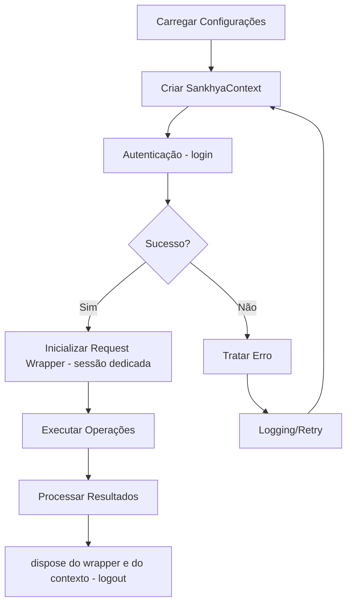

# Início Rápido

Este guia mostra como criar sua primeira integração com a API Sankhya usando o SDK Python.

## Exemplo "Hello World"

O exemplo mais simples de uso do SDK:

```python
from sankhya_sdk.auth.oauth_client import OAuthClient
from sankhya_sdk.http.session import SankhyaSession
from dotenv import load_dotenv
import os

load_dotenv()

# 1. Configurar Cliente OAuth
oauth = OAuthClient(
    base_url=os.getenv("SANKHYA_AUTH_BASE_URL", "https://api.sankhya.com.br"),
    token=os.getenv("SANKHYA_TOKEN")
)

# 2. Autenticar
oauth.authenticate(
    client_id=os.getenv("SANKHYA_CLIENT_ID"),
    client_secret=os.getenv("SANKHYA_CLIENT_SECRET")
)

# 3. Criar Sessão
session = SankhyaSession(oauth_client=oauth)

print("Conectado com sucesso via OAuth2!")
response = session.get("/gateway/v1/mge/teste")
print(f"Status: {response.status_code}")
```

## Sua Primeira Consulta

### Abordagem Moderna: Gateway Client (Recomendada)

O `GatewayClient` oferece uma interface simplificada para a API JSON:

```python
from sankhya_sdk.auth import OAuthClient
from sankhya_sdk.http import SankhyaSession, GatewayClient
from dotenv import load_dotenv
import os

load_dotenv()

# 1. Configurar OAuth
oauth = OAuthClient(
    base_url=os.getenv("SANKHYA_BASE_URL", "https://api.sankhya.com.br"),
    token=os.getenv("SANKHYA_TOKEN")
)

# 2. Autenticar
oauth.authenticate(
    client_id=os.getenv("SANKHYA_CLIENT_ID"),
    client_secret=os.getenv("SANKHYA_CLIENT_SECRET")
)

# 3. Criar sessão e cliente
session = SankhyaSession(oauth_client=oauth)
client = GatewayClient(session)

# 4. Consultar parceiros
result = client.load_records(
    entity="Parceiro",
    fields=["CODPARC", "NOMEPARC", "CGC_CPF"],
    criteria="ATIVO = 'S' AND CLIENTE = 'S'"
)

# 5. Processar resultados (metodo recomendado)
records = GatewayClient.extract_records(result)

for record in records:
    print(f"{record['CODPARC']}: {record['NOMEPARC']}")
```

!!! tip "Recomendação"
    Para novos projetos, use o `GatewayClient` com DTOs. Esta é a abordagem mais moderna e oferece melhor performance.

### Abordagem Clássica: SankhyaContext (Legado)

Vamos buscar dados de parceiros (clientes/fornecedores) pela API XML, com
usuário e senha. As credenciais vêm de `SankhyaSettings` (variáveis
`SANKHYA_URL`, `SANKHYA_PORT`, `SANKHYA_USERNAME` e `SANKHYA_PASSWORD`, ou o
arquivo `.env`):

```python
from sankhya_sdk import SankhyaContext
from sankhya_sdk.models.transport import Partner
from sankhya_sdk.request_wrappers import SimpleCRUDRequestWrapper

ctx = SankhyaContext.from_settings()  # autentica a sessão principal
try:
    # Adquire uma sessão dedicada para o wrapper (um login extra)
    SimpleCRUDRequestWrapper.initialize(ctx)

    # Busca os parceiros ativos
    partners = SimpleCRUDRequestWrapper.find_all(Partner(is_active=True))

    # Exibe resultados
    for partner in partners:
        print(f"Código: {partner.code}")
        print(f"Nome: {partner.name}")
        print("-" * 40)
finally:
    SimpleCRUDRequestWrapper.dispose()  # logout da sessão dedicada
    ctx.dispose()                       # logout das demais sessões
```

## Entendendo o Código

### 1. Contexto e sessões

O `SankhyaContext` gerencia o ciclo de vida das sessões. `dispose()` faz o
logout de todas as sessões registradas:

```python
from sankhya_sdk import SankhyaContext

ctx = SankhyaContext.from_settings()  # Conexão aberta (login)
try:
    ...
finally:
    ctx.dispose()  # Conexão fechada (logout)
```

Também é possível usar `with`. Nesse caso a variável do `with` recebe o
`SankhyaWrapper` da sessão principal, não o contexto:

```python
from sankhya_sdk import SankhyaContext

with SankhyaContext.from_settings() as wrapper:
    # `wrapper` é um SankhyaWrapper (service_invoker, get_file, ...)
    ...
# dispose() chamado automaticamente (logout)
```

!!! warning "Sempre libere o contexto"
    Use `with` ou `try/finally` com `dispose()`. O `__del__` do
    `SankhyaContext` apenas marca o contexto como descartado (como o
    finalizer do SDK .NET): um contexto que sai de escopo sem `dispose()`
    não faz logout, e suas sessões continuam registradas.

### 2. Request Wrappers

O SDK fornece wrappers de alto nível para operações comuns:

| Wrapper | Descrição |
|---------|-----------|
| `SimpleCRUDRequestWrapper` | Operações CRUD básicas (métodos de classe; `initialize(ctx)` adquire uma sessão dedicada) |
| `PagedRequestWrapper` | Consultas paginadas para grandes volumes |
| `OnDemandRequestWrapper` | Processamento em lote em segundo plano |
| `KnowServicesRequestWrapper` | Serviços específicos (notas, faturamento, avisos, sessões, arquivos) |

### 3. Transport Entities

Entidades pré-definidas para interação com a API:

```python
from sankhya_sdk.models.transport import (
    Partner,        # Parceiros (clientes/fornecedores)
    Product,        # Produtos
    InvoiceHeader,  # Cabeçalho de notas fiscais
    # ... e mais
)
```

## Exemplo Completo: CRUD de Parceiros

Os exemplos a seguir assumem o `SimpleCRUDRequestWrapper` inicializado como
acima (`SimpleCRUDRequestWrapper.initialize(ctx)` e, ao final,
`SimpleCRUDRequestWrapper.dispose()` e `ctx.dispose()`).

### Buscar (Find)

```python
from sankhya_sdk.helpers import EntityQueryOptions, LiteralCriteria
from sankhya_sdk.models.transport import Partner
from sankhya_sdk.request_wrappers import SimpleCRUDRequestWrapper

# Busca pela chave primária (None se não existir)
partner = SimpleCRUDRequestWrapper.try_find(Partner(code=1))

# Busca obrigatória (ServiceRequestUnexpectedResultException se não existir)
partner = SimpleCRUDRequestWrapper.find(Partner(code=1))

# Todos os parceiros que correspondem aos campos preenchidos
clients = SimpleCRUDRequestWrapper.find_all(Partner(is_client=True, is_active=True))

# Busca com opções (limite de linhas, sem entidades referenciadas)
options = EntityQueryOptions(max_results=100, include_references=False)
active = SimpleCRUDRequestWrapper.find_all(Partner(is_active=True), options)

# Busca por critério literal (no máximo um resultado)
partner = SimpleCRUDRequestWrapper.try_find_with_criteria(
    Partner, LiteralCriteria.equals("CGC_CPF", "12345678000199")
)
```

### Atualizar (Update)

```python
from sankhya_sdk.models.transport import Partner
from sankhya_sdk.request_wrappers import SimpleCRUDRequestWrapper

# Busca o parceiro
partner = SimpleCRUDRequestWrapper.try_find(Partner(code=1))

if partner:
    partner.email_address = "novo@email.com"

    # Atualiza (CRUDServiceProvider.saveRecord)
    result = SimpleCRUDRequestWrapper.update(partner)
    print(f"Parceiro atualizado: {result.code}")
```

### Update Parcial (GatewayClient - Recomendado)

Para atualizar apenas alguns campos sem enviar todos os campos obrigatorios:

```python
from sankhya_sdk.auth import OAuthClient
from sankhya_sdk.http import SankhyaSession, GatewayClient
import os

# Autenticacao OAuth2
oauth = OAuthClient(base_url=os.getenv("SANKHYA_AUTH_BASE_URL"))
oauth.authenticate(
    client_id=os.getenv("SANKHYA_CLIENT_ID"),
    client_secret=os.getenv("SANKHYA_CLIENT_SECRET")
)

session = SankhyaSession(oauth_client=oauth)
client = GatewayClient(session)

# UPDATE PARCIAL - envia apenas os campos alterados
client.save_record(
    entity="Parceiro",
    fields={"EMAIL": "novo@email.com"},
    pk={"CODPARC": 123}  # Chave primaria
)

# Funciona com qualquer entidade
client.save_record(
    entity="Financeiro",
    fields={"DTVENC": "20/02/2026"},
    pk={"NUFIN": 45678}
)
```

!!! tip "Vantagem do Update Parcial"
    Ao usar o parametro `pk`, o SDK utiliza internamente o servico `DatasetSP.save`, que permite atualizar apenas os campos especificados sem exigir todos os campos obrigatorios da entidade.

### Criar (Insert)

Não existe um método `insert`: `update` usa `CRUDServiceProvider.saveRecord`
e, sem chave primária preenchida, o servidor cria o registro (como no SDK
.NET):

```python
from sankhya_sdk.models.transport import Partner
from sankhya_sdk.request_wrappers import SimpleCRUDRequestWrapper

# Cria novo parceiro (sem CODPARC)
new_partner = Partner(
    name="Novo Cliente LTDA",
    document="12345678000199",
    is_client=True,
)

result = SimpleCRUDRequestWrapper.update(new_partner)
print(f"Parceiro criado com código: {result.code}")
```

### Remover (Delete)

```python
from sankhya_sdk.models.transport import Partner
from sankhya_sdk.request_wrappers import SimpleCRUDRequestWrapper

# Remove pelo código (chave primária); não há valor de retorno
SimpleCRUDRequestWrapper.remove(Partner(code=999))
print("Parceiro removido")
```

## Tratamento de Erros

Sempre trate exceções para uma integração robusta:

```python
from sankhya_sdk import SankhyaContext
from sankhya_sdk.exceptions import (
    SankhyaException,
    ServiceRequestGeneralException,
    ServiceRequestInvalidCredentialsException,
)
from sankhya_sdk.models.transport import Partner
from sankhya_sdk.request_wrappers import SimpleCRUDRequestWrapper

try:
    ctx = SankhyaContext.from_settings()
except ServiceRequestInvalidCredentialsException:
    print("Erro: Credenciais inválidas")
    raise

try:
    SimpleCRUDRequestWrapper.initialize(ctx)
    partners = SimpleCRUDRequestWrapper.find_all(Partner(is_active=True))

except ServiceRequestGeneralException as e:
    print(f"Erro na requisição: {e}")
    if e.response is not None:
        print(f"Status: {e.response.status_message_text}")

except SankhyaException as e:
    print(f"Erro geral do SDK: {e}")

finally:
    SimpleCRUDRequestWrapper.dispose()
    ctx.dispose()
```

As exceções de autenticação (`ServiceRequestInvalidCredentialsException` e
afins) não derivam de `SankhyaException`. Veja
[Tratamento de Erros](../core-concepts/error-handling.md).

## Logging

O SDK suporta logging integrado:

```python
import logging

from sankhya_sdk import SankhyaContext

# Configura logging
logging.basicConfig(
    level=logging.DEBUG,
    format='%(asctime)s - %(name)s - %(levelname)s - %(message)s'
)

# Os módulos do SDK usam loggers sob 'sankhya_sdk' (ex.: 'sankhya_sdk.core.wrapper')
logger = logging.getLogger('sankhya_sdk')
logger.setLevel(logging.DEBUG)

with SankhyaContext.from_settings() as wrapper:
    # Logs detalhados serão exibidos
    ...
```

## Fluxo Típico de Integração



## Próximos Passos

- [Autenticação](authentication.md) - Métodos avançados de autenticação
- [Arquitetura](../core-concepts/architecture.md) - Entenda a arquitetura do SDK
- [Exemplos](../examples/index.md) - Mais exemplos práticos
- [Referência da API](../api-reference/index.md) - Documentação completa
